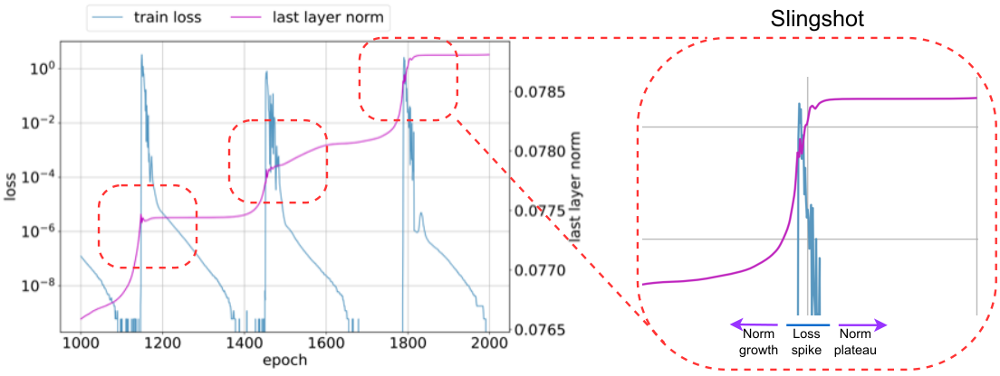

#  Generalization and Learning Theory


## Bias-Variance Tradeoff

**Definitions**:

- **Bias**: Error from incorrect assumptions (e.g., linear model for nonlinear data)
- **Variance**: Error from sensitivity to training set fluctuations

**Decomposition** (for squared loss):
$$\mathbb{E}[(y - \hat{y})^2] = \text{Bias}[\hat{y}]^2 + \text{Var}[\hat{y}] + \text{Noise}$$

**Identifying Issues**:

1. **High Bias** (underfitting):
   - Train error >> human-level performance
   - Train error ≈ validation error (both high)
   - **Solutions**: Increase model capacity, train longer, reduce regularization

2. **High Variance** (overfitting):

   - Train error << validation error (large gap)
   - Train error ≈ human-level performance
   - **Solutions**: More data, regularization, simpler model

**Modern Deep Learning Paradox**: 

- Classical theory: Larger models should overfit more
- Reality: Over-parameterized networks often generalize better
- **Double Descent**: Test error initially increases with model size (classical regime), then decreases again (modern regime)

**Interview Insight**: 
Be prepared to discuss why deep learning defies classical bias-variance intuition. Theories include implicit regularization from SGD, the "lottery ticket hypothesis," and interpolation vs. extrapolation regimes.

---


## Regularization Techniques

### L2 Regularization (Weight Decay)

**Modified Loss**:
$$\mathcal{L}_{\text{reg}}(\theta) = \mathcal{L}(\theta) + \frac{\lambda}{2} \|\mathbf{W}\|_F^2$$

where $\|\mathbf{W}\|_F = \sqrt{\sum_{ij} W_{ij}^2}$ is the Frobenius norm.

**Update Rule**:
$$\mathbf{W}_{t+1} = \mathbf{W}_t - \alpha(\nabla_W \mathcal{L} + \lambda \mathbf{W}_t) = (1-\alpha\lambda)\mathbf{W}_t - \alpha \nabla_W \mathcal{L}$$

**Effect**: Shrinks weights toward zero each step ("weight decay"). Equivalent to MAP estimation with Gaussian prior on weights.

**Typical Values**: $\lambda \in [10^{-5}, 10^{-3}]$

---

### L1 Regularization (Lasso)

**Modified Loss**:
$$\mathcal{L}_{\text{reg}}(\theta) = \mathcal{L}(\theta) + \lambda \|\mathbf{W}\|_1$$

where $\|\mathbf{W}\|_1 = \sum_{ij} |W_{ij}|$.

**Effect**: Promotes sparsity (many weights exactly zero). Equivalent to MAP with Laplace prior.

**Use Case**: Feature selection, interpretability, model compression.

---

### Dropout (Covered in §1.2.3)

**Additional Perspective**: 
Dropout can be viewed as a form of Bayesian approximation—training stochastic sub-networks approximates integrating over model uncertainty.

---

### Data Augmentation

**Definition**: Apply label-preserving transformations to training data:
- **Vision**: Rotation, flipping, cropping, color jittering, mixup
- **NLP**: Synonym replacement, back-translation, word dropout
- **Audio**: Time stretching, pitch shifting, noise injection

**Why It Works**: 
- Increases effective dataset size
- Encodes domain-specific invariances (e.g., object recognition should be translation-invariant)

**Practical Note**: Augmentation is the *most important* regularization for vision tasks. Allocate effort here before tuning other hyperparameters.

---

### Label Smoothing

**Motivation**: Hard labels (one-hot vectors) encourage overconfident predictions. Models can achieve zero cross-entropy loss by outputting extreme logits, which hurts calibration.

**Method**: Replace $y \in \{0,1\}^K$ with:
$$\tilde{y}_k = \begin{cases}
1 - \epsilon & \text{if } k = c \text{ (true class)} \\
\epsilon / (K-1) & \text{otherwise}
\end{cases}$$

where $\epsilon \in [0.1, 0.2]$ is the smoothing parameter.

**Effect**: 
- Prevents model from becoming too confident
- Improves calibration (predicted probabilities match true frequencies)
- Acts as implicit regularization

---

### Early Stopping

**Algorithm**:
1. Monitor validation loss every epoch
2. Stop training when validation loss hasn't improved for $n$ epochs (patience)
3. Restore weights from best validation epoch

**Intuition**: Validation loss initially decreases with training loss, then starts increasing (overfitting). Early stopping finds the "sweet spot."

**Criticism**: Couples optimization (minimizing training loss) with regularization (preventing overfitting). Modern practice prefers explicit regularization + training to convergence.

**When to Use**: Quick experiments, when computational budget is limited, or when other regularization is insufficient.

---

### Model Ensembles

**Definition**: Train multiple models independently and average predictions:
$$\hat{y}_{\text{ensemble}} = \frac{1}{M} \sum_{i=1}^M \hat{y}^{(i)}$$

**Variants**:

- Different random initializations
- Different architectures
- Different hyperparameters
- Different data subsets (bagging)

**Why It Works**: 

- Reduces variance (errors of individual models are partially uncorrelated)
- Can reduce bias if models are diverse
- Almost always improves performance (at cost of $M\times$ compute)

**Practical Use**: 

- Kaggle competitions (critical for winning)
- Production systems where performance is crucial
- Not suitable for real-time or resource-constrained applications

---


## Understanding Overfitting Mechanisms

**Classical View**: Overfitting occurs when models learn noise rather than signal. However, modern deep learning reveals this intuition is incomplete—we need to understand *how* and *why* networks overfit.

### Capacity and Memorization

**VC Dimension**: The largest number of points a model can perfectly classify for all possible labelings. For neural networks:

- Linear classifier in $\mathbb{R}^d$: $\text{VC} = d + 1$
- Two-layer ReLU network: $\text{VC} = O(W^2)$ where $W$ is total parameters

**Empirical Finding** (Zhang et al., 2017; see @sec-modern-puzzles): Neural networks can perfectly fit random labels—demonstrating they have *capacity* to memorize. Yet on real data, they *prefer* to learn patterns first.

**Rademacher Complexity**: A data-dependent capacity measure that predicts generalization better than parameter count alone. For dataset $\mathcal{S}$:

$$\hat{\mathcal{R}}_\mathcal{S}(\mathcal{H}) = \mathbb{E}_{\boldsymbol{\sigma}} \left[ \sup_{h \in \mathcal{H}} \frac{1}{m} \sum_{i=1}^m \sigma_i h(\mathbf{x}_i) \right]$$

where $\sigma_i \in \{-1, +1\}$ are random labels. Higher complexity → can fit random noise → higher overfitting risk.

---

### Sharp vs. Flat Minima

**Loss Landscape Geometry**: Not all zero-training-loss solutions generalize equally.

- **Sharp minimum**: Small weight perturbations cause large loss increase
- **Flat minimum**: Loss remains stable under perturbations

**Connection to Generalization** (Hochreiter & Schmidhuber, 1997): Flat minima generalize better because they occupy larger volumes in parameter space—a form of Occam's razor.

**Why SGD Finds Flat Minima**:

- Large batch → converges to sharp minima → poor generalization
- Small batch → noisy gradients → flat minima → better generalization

The noise in mini-batch SGD acts as implicit regularization, preventing convergence to sharp, overfitting solutions.

**Practical Implication**: Batch size affects generalization not just through gradient estimation, but through the geometry of the solutions found.

**Edge of Stability** (Cohen et al., 2021) [@cohen2021eos]: Flat vs. sharp describes *where* training ends; the Edge of Stability explains *why the step size limits how sharp it can get*. Define **sharpness** as the largest Hessian eigenvalue $\lambda_{\max}$. Gradient descent with step size $\eta$ is unstable on a quadratic once $\lambda_{\max} > 2/\eta$. Empirically, full-batch GD first sharpens steadily ("progressive sharpening") until $\lambda_{\max} \approx 2/\eta$, then **hovers right at that threshold** while the loss keeps falling non-monotonically.

{#fig-eos width=95%}

So $\eta$ caps the sharpness of the solution: **larger step sizes end in flatter minima**, a deterministic counterpart to the small-batch noise argument above. The two are related but not the same: flat minima are a property of the *solution*, Edge of Stability a property of the *trajectory* (shown for full-batch GD, without SGD noise).

---

### Implicit Regularization from Optimization

**Key Insight**: The optimization algorithm itself regularizes, beyond explicit terms in the loss.

**Evidence**:
1. **Max-Margin Solutions** (Soudry et al., 2018): For separable data, gradient descent on cross-entropy converges to the maximum-margin classifier (SVM solution), even without explicit margin maximization.

2. **Simplicity Bias**: SGD learns low-frequency patterns before high-frequency noise. This can be formalized via Neural Tangent Kernel theory—networks learn functions in order of increasing NTK eigenvalues.

3. **Early Stopping Exploits This**: Stopping before complete interpolation retains learned structure while discarding noise.

**Interview Insight**: When asked "Why do large networks generalize?", mention multiple mechanisms working together: implicit regularization from SGD, architecture inductive biases, flat minima preference, and simplicity bias. No single explanation is complete.

---

## Modern Generalization Puzzles {#sec-modern-puzzles}

Classical theory predicts that over-parameterized models should catastrophically overfit. The puzzle was made concrete by Zhang et al. (2017) [@zhang2017rethinking]: standard networks reach **zero training error even when the labels are replaced by random ones**—so they have the capacity to memorize anything—yet on real labels the same networks generalize well. Capacity-based bounds (VC dimension, parameter counts) cannot tell these two cases apart, so something else must explain generalization.

{#fig-random-labels width=95%}

The phenomena below are different answers to that question: double descent (capacity is not the right axis), lottery tickets (which subnetwork is trained), and grokking (when generalization emerges). The mechanisms that select *which* zero-loss solution is found—flat minima and the Edge of Stability—are in the previous section.

### Double Descent Phenomenon

**Discovery** (Belkin et al., 2019; Nakkiran et al., 2020): Test error follows a **double descent curve** rather than the classical U-shape:

```
Test Error
    ^
    |   Classical  | Modern
    |    Regime    | Regime
    |              |
    |   ∩         ∩|
    |  / \       / |
    | /   \_____/  |
    |______________|_____> Model Capacity
           ↑
    Interpolation
     Threshold
```

**Three Regimes**:

1. **Under-parameterized** ($\mathcal{C} < \mathcal{C}_{\text{interp}}$): Classical U-curve—insufficient capacity forces generalization
2. **Interpolation threshold** ($\mathcal{C} \approx \mathcal{C}_{\text{interp}}$): Peak test error—forced to fit noise with high-frequency components
3. **Over-parameterized** ($\mathcal{C} > \mathcal{C}_{\text{interp}}$): Test error decreases—multiple interpolating solutions exist, optimization finds simpler ones

**Why This Occurs**: When many solutions achieve zero training loss, gradient descent converges to the minimum-norm solution. In high dimensions, this tends to be smoother and generalizes better.

**Practical Implications**:

- More parameters can improve generalization (beyond classical intuition)
- Regularization can worsen performance at interpolation threshold (reduces effective capacity)
- Modern LLMs operate deep in over-parameterized regime (GPT-3: 175B parameters)

**Interview Question**: "Should we worry about overfitting with billion-parameter models?"

**Answer**: Depends on regime. If $|\theta| \gg |\mathcal{D}|$, we're over-parameterized where implicit regularization dominates. Still need sufficient data for task complexity and proper optimization.

---

### The Lottery Ticket Hypothesis

**Statement** (Frankle & Carlin, 2019): 
> A randomly-initialized dense network contains a sparse subnetwork that—when trained in isolation with its original initialization—matches the full network's test accuracy.

**Formal Definition**: Given network with initialization $\theta_0$, there exists a binary mask $\mathbf{m} \in \{0,1\}^{|\theta|}$ such that:

$$f(\mathbf{x}; \mathbf{m} \odot \theta_0) \text{ trained achieves similar accuracy as } f(\mathbf{x}; \theta_0)$$

where $||\mathbf{m}||_0 \ll |\theta|$ (e.g., 10-20% of weights).

**Key Insight**: The specific initialization matters as much as architecture—winning tickets exist in the initialization lottery.

**Finding Tickets - Iterative Magnitude Pruning**:  

1. Train network: $\theta_0 \rightarrow \theta_T$
2. Prune smallest magnitude weights by $|\theta_{T,i}|$
3. **Reset remaining weights to** $\theta_0$ (not re-randomize)
4. Repeat

**Crucially**: Must reset to original $\theta_0$—this specific initialization is the "ticket."

**Theoretical Implications**:

- **Over-parameterization as search space**: Large networks contain more potential tickets
- **Initialization contains seeds**: Training reveals which subset of initial weights to use
- **Connection to optimization**: SGD searches over exponentially many subnetworks implicitly

**Weak Lottery Tickets** (Frankle et al., 2020): For large-scale networks, must reset to $\theta_k$ (after $k$ early epochs) instead of $\theta_0$ for stability. Enables lottery tickets in ResNets, Transformers.

**Practical Applications**:

- **Model compression**: Train large → find ticket → deploy small
- **Training efficiency**: Prune early, continue training pruned network
- **Understanding hyperparameters**: Learning rate, batch size affect *which ticket is found*

**Open Questions**:

- Theoretical conditions guaranteeing ticket existence?
- Connection to double descent and implicit regularization?
- Universal tickets that transfer across tasks?

**Interview Insight**: Lottery tickets explain why over-parameterization helps: more parameters → more diverse subnetworks → higher probability of finding good solutions. Connects initialization, architecture, and optimization.

---

### Grokking

**Discovery** (Power et al., 2022) [@power2022grokking]: Training a small transformer on algorithmic tasks (e.g., modular division) can produce **grokking**—training accuracy hits ~100% almost immediately, while validation accuracy stays at chance for $10^2$–$10^3\times$ longer before *suddenly* jumping to ~100% as well, long after the model appears to have "finished" overfitting.

{#fig-grokking width=55%}

**Why This Occurs**: Mechanistic-interpretability work (Nanda et al., 2023) [@nanda2023progress] shows the network passes through distinct phases: it first **memorizes** the training set with a high-norm, non-generalizing solution, then—driven by weight decay—slowly **forms a generalizing circuit** (e.g., Fourier-based algorithms for modular arithmetic) that coexists with the memorized solution, and finally **cleans up** the memorization once the generalizing circuit dominates. Validation accuracy only rises once this circuit formation crosses a threshold—long after training loss has bottomed out.

**The Slingshot Effect** (Thilak et al., 2022) [@thilak2022slingshot] offers a complementary optimizer-level account of *why* this transition happens when it does: with adaptive optimizers (Adam/AdamW) and no explicit regularization, the last layer's weight norm cycles through rapid growth, a training-loss spike, and a plateau—and grokking is observed almost exclusively to begin at the onset of one of these "slingshot" cycles.

{#fig-slingshot width=85%}

**Interview Question**: "If training loss has converged to ~0, is there anything left to learn?"

**Answer**: Not necessarily true for over-parameterized networks with weight decay. Grokking shows a model can memorize (zero training loss) long before it generalizes—weight decay keeps pressuring the optimizer toward a simpler, lower-norm solution even after the training loss plateaus, and generalization can emerge abruptly, well after training loss stops being informative.

---

**Synthesis**: Modern generalization is explained by multiple interacting phenomena:

- **Double descent**: Over-parameterization enables simpler interpolating solutions
- **Lottery tickets**: Initialization space contains rare good subnetworks
- **Grokking**: Weight decay can drive a delayed transition from a memorizing to a generalizing solution, long after training loss has converged
- **Implicit regularization**: SGD bias toward flat minima and simple solutions
- **Architecture biases**: Convolutions, attention impose structured priors

Understanding these mechanisms is essential for designing scalable deep learning systems and explains why practices like massive over-parameterization and careful initialization matter in production.


---


## Summary and Interview Preparation

### Core Concepts Checklist

**Generalization**:

- [ ] Bias-variance decomposition
- [ ] L1 vs. L2 regularization effects
- [ ] When to use dropout, data augmentation, ensembles
- [ ] Early stopping vs. training to convergence
- [ ] Double descent and over-parameterized regime behavior
- [ ] Sharp vs. flat minima: why batch size affects generalization**


### Common Interview Questions

1. **"How do you diagnose overfitting?"**
   - Large train-validation gap; try regularization, more data, simpler model

2. **"Explain vanishing/exploding gradients."**
   - Repeated multiplication of Jacobians → exponential decay/growth
   - Solutions: Better initialization, normalization, skip connections

3. **"Why do over-parameterized networks generalize well?"**
   - Double descent  
   - Implicit regularization from SGD  
   - Lottery ticket hypothesis  
   - Flat minima


### Practical Tips for Interviews

???


### Further Reading

- **Generalization**: [Understanding Deep Learning Requires Rethinking Generalization](https://arxiv.org/abs/1611.03530), [Edge of Stability](https://arxiv.org/abs/2103.00065)
- **Modern Generalization**: [Deep Double Descent](https://arxiv.org/abs/1912.02292), [Lottery Ticket Hypothesis](https://arxiv.org/abs/1803.03635)
- **Grokking**: [Power et al., 2022 (original paper)](https://arxiv.org/abs/2201.02177), [Nanda et al., 2023 (mechanistic account)](https://arxiv.org/abs/2301.05217), [Thilak et al., 2022 (Slingshot Effect)](https://arxiv.org/abs/2206.04817) — for the most in-depth, up-to-date treatment, see the survey [Bertolotti & Cazzola, "A Survey on Grokking," ACM Computing Surveys (2026)](https://doi.org/10.1145/3814603)


This completes Part I: Deep Learning Foundations.  
The next chapters will build on these fundamentals to cover specialized architectures (CNNs, Transformers) for image understanding.  