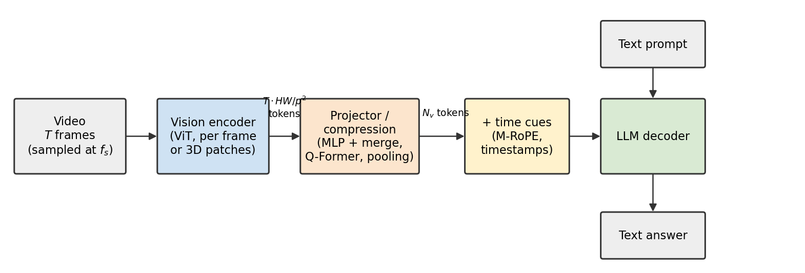

# Video-Language Understanding {#sec-video-vlm}

An image is a snapshot; a video is a snapshot with a plot. Questions like "why did the man leave the kitchen?", "what happened *after* the goal?" or "how many times did she open the fridge?" cannot be answered from any single frame, and they are exactly what video-language models are asked in practice. Since 2023 the dominant recipe has been to take an image VLM (see the Vision-Language chapter), feed it a *sequence* of frames, and let a large language model do the temporal reasoning in text space. This chapter covers the tasks, the recipe (frame sampling, token budget, temporal positions), the models an interviewer expects you to know, and the benchmarks, with their pitfalls, used to compare them.

Backbones for pure video representation (3D CNNs, video transformers, VideoMAE, V-JEPA) live in @sec-video-fundamentals; retrieval and temporal grounding in @sec-video-retrieval; tracking and video segmentation in @sec-video-tracking.

## The Task Map

Let $\mathbf{V} = (\mathbf{I}_1, \ldots, \mathbf{I}_T) \in \mathbb{R}^{T \times H \times W \times 3}$ be a clip. Every task below asks for some function of $\mathbf{V}$ (and sometimes a text query $q$).

| Task | Input / output | Typical metric | What it really tests |
|:-----|:---------------|:---------------|:---------------------|
| **Action recognition** | clip $\to$ one of $K$ labels | top-1 accuracy (mAP if multi-label) | appearance and, on motion-centric data, dynamics |
| **Captioning** | clip $\to$ sentence (or timestamped paragraph for *dense* captioning) | CIDEr, METEOR; LLM judge | perception plus fluent summarisation |
| **Video QA** | clip + question $\to$ answer (multiple choice or open-ended) | accuracy; LLM-judge for open-ended | perception, temporal and causal reasoning |
| **Long-video understanding** | minutes to hours of video + question | accuracy | memory, retrieval of the one relevant moment |
| **Egocentric understanding** | first-person video (Ego4D, EPIC-Kitchens) | task-specific | hand-object interaction, long continuous activity |

Three neighbours are *not* treated here: text-video retrieval and moment localisation ("find *when*", @sec-video-retrieval, @sec-moment-retrieval), and tracking / video object segmentation ("follow *what*", @sec-video-tracking).

Two facts frame everything that follows. First, **frames are cheap to describe and expensive to read**: a 10-minute video at 30 fps is 18 000 frames, and no LLM context holds that many images. Second, **language models are strong priors**: much of what looks like video understanding can be answered from the question text alone, which is why evaluation (last section) deserves as much suspicion as the models.

## The Video-LLM Recipe

### Anatomy

Nearly all video LLMs share the template of @fig-video-llm: a vision encoder turns frames into tokens, a projector compresses and maps them into the LLM's embedding space, and the LLM decodes an answer conditioned on the visual tokens and the text prompt. The bridge was pioneered for images by BLIP-2 [@li2023blip2] and made radically simpler by LLaVA [@liu2023llava] (a CLIP ViT, a two-layer MLP, and an instruction-tuned LLM). Video models mostly just feed more frames through the same pipe.

{#fig-video-llm width=95% fig-align="center"}

Training is usually staged: (i) align the projector with image-text pairs while the encoder and LLM are frozen; (ii) unfreeze more of the model on image and video captions; (iii) instruction-tune on video QA and dialogue data, often synthetic, generated by a stronger model from captions. Data quality (dense, accurate captions) has mattered more than architecture tweaks since LLaVA-Video [@li2024llavavideo] built its 178K-sample synthetic instruction set.

### Frame sampling and the token budget

A ViT with patch size $p$ emits $HW/p^2$ tokens per frame, so a clip costs

$$
N_v \;=\; \frac{T}{\tau}\cdot\frac{H W}{p^2 r^2},
$$

where $r$ is the spatial merge factor (e.g. $r=2$ merges $2\times2$ neighbouring tokens into one) and $\tau$ is the temporal merge factor (e.g. $\tau=2$ when a 3D convolution fuses two consecutive frames). Concretely, with $448\times448$ frames, $p=14$, $r=2$, $\tau=2$ and 2 fps sampling, each *second* of video costs $256$ tokens and a 10-minute clip costs about $153\text{K}$ tokens. Every design choice below is a way to spend this budget better:

- **Sample fewer frames, smartly.** Uniform sampling (a fixed number of frames, evenly spaced) is the default; 1-2 fps is common. It silently misses events shorter than the sampling interval. Adaptive schemes pick frames by similarity to the query or by visual change.
- **Trade space for time.** LLaVA-Video's *SlowFast* representation keeps a few frames at full token count and many frames at heavy pooling, so the model sees both fine detail and long temporal coverage (the name is borrowed from the SlowFast network of @sec-video-fundamentals).
- **Compress tokens.** Learned queries (Q-Former or Perceiver Resampler), parameter-free spatial merging or pooling, or temporal pooling. LLaMA-VID [@li2024llamavid] extreme case: two tokens per frame.
- **Extend the context instead.** LongVA [@zhang2024longva] first stretches the *language model's* context and then relies on it to transfer to many frames, while LongVU [@shen2024longvu] compresses redundant frames adaptively. Both camps exist because neither strategy wins everywhere.

::: {.callout-note collapse="true" title="Code: uniform frame sampling and token count"}
```python
import numpy as np

def sample_indices(num_frames: int, native_fps: float, target_fps: float,
                   max_frames: int) -> np.ndarray:
    """Evenly spaced frame indices at ~target_fps, capped at max_frames."""
    step = max(native_fps / target_fps, 1.0)
    idx = np.arange(0, num_frames, step).astype(int)
    if len(idx) > max_frames:  # too long: fall back to uniform subsampling
        idx = np.linspace(0, num_frames - 1, max_frames).astype(int)
    return idx

def visual_tokens(num_sampled: int, h: int, w: int, patch: int = 14,
                  merge: int = 2, temporal_merge: int = 2) -> int:
    per_frame = (h // patch // merge) * (w // patch // merge)
    return (num_sampled // temporal_merge) * per_frame

idx = sample_indices(18_000, 30.0, 2.0, max_frames=1_200)
print(len(idx), visual_tokens(len(idx), 448, 448))  # 1200 frames, 153600 tokens
```
:::

### Telling the LLM *when*

Tokens from different frames look alike; the LLM must learn which came first, and "at what time". Three solutions:

1. **Plain text timestamps.** Insert a string such as `<t=12.0s>` before each frame's tokens (TimeChat and LLaVA-MR-style models, and Qwen3-VL's explicit textual timestamps). Simple and surprisingly effective for grounding; costs context.
2. **Index-based 1D RoPE.** Treat the visual tokens as one flat sequence. Time is implicit in the order; spatial layout is mostly lost.
3. **Multimodal RoPE (M-RoPE).** Give each token a triple of ids $(p_t, p_h, p_w)$ and split the head dimension into three chunks, rotating chunk $a$ by the angle for position $p_a$. For text tokens, $p_t=p_h=p_w$, so M-RoPE reduces exactly to standard 1D RoPE [@su2024roformer]; for a video token, $p_t$ is the frame (or time) index and $(p_h,p_w)$ its patch coordinates. Qwen2.5-VL goes one step further and ties $p_t$ to *absolute time*, $p_t = \lfloor \tau_{\text{sec}} / \delta \rfloor$ for a fixed $\delta$, so that the same id means the same number of seconds regardless of the sampling rate.

![M-RoPE in Qwen2-VL: each visual token carries a (time, height, width) position id; text tokens continue the numbering with the same id on all three axes [@wang2024qwen2vl].](/images/video/qwen2vl_mrope.png){#fig-mrope width=90% fig-align="center"}

## The Qwen-VL Story (Compressed)

The Qwen-VL family is a convenient timeline of how the field's defaults changed.

- **Qwen-VL** [@bai2023qwenvl] is a single-image model built on the BLIP-2 idea: a ViT, a *position-aware cross-attention adapter* with 256 learned queries (the Q-Former heir), and an LLM. Fixed input resolution; no video.
- **Qwen2-VL** [@wang2024qwen2vl] drops fixed resolution and the query adapter. Images enter at *native dynamic resolution* (variable number of tokens), neighbouring $2\times2$ patches are merged by an MLP, and M-RoPE replaces 1D RoPE. Video is sampled at 2 fps and a 3D convolution of temporal depth 2 fuses frame pairs (an image is treated as two identical frames, so images and video share one code path), with a cap on tokens per video.
- **Qwen2.5-VL** [@bai2025qwen25vl] makes the ViT cheaper with *window attention* (full attention only in a few layers), and aligns M-RoPE's time axis with absolute time so that dynamic-FPS sampling still gives the model a usable clock (@fig-qwen25). This is what makes second-level event localisation in long videos possible.
- **Qwen3-VL** [@team2025qwen3vl] continues in the same direction with a much longer native context, interleaved M-RoPE and explicit text timestamps; treat details beyond that as something to check in the report.

![Qwen2.5-VL: native-resolution images and variable-FPS video become variable-length token sequences, and M-RoPE time ids are aligned with absolute time [@bai2025qwen25vl].](/images/video/qwen25vl_framework.png){#fig-qwen25 width=90% fig-align="center"}

The lesson is the direction of travel: *learned query bottlenecks out, simple merging plus structured positions in*. A Q-Former forces a fixed number of tokens per frame regardless of content and must be trained from scratch; merging keeps the encoder's output, and positions carry the structure.

![BLIP-2: a Q-Former with a fixed set of learned queries bridges a frozen image encoder and a frozen LLM [@li2023blip2]. The same bridging idea powered the first generation of video LLMs.](/images/vision_language/blip_2.png){#fig-blip2-video width=80% fig-align="center"}

## Representative Models

| Model | Idea | Why it matters |
|:------|:-----|:---------------|
| **VideoChat / VideoChat2** [@li2023videochat; @li2024mvbench] | video encoder + Q-Former into an LLM, instruction-tuned on a large video instruction set | early "chat about a video" baseline; VideoChat2 shipped alongside MVBench |
| **Video-LLaVA** [@lin2023videollava] | align image and video features into a *shared* space *before* projection, then train one projector on both | images and video help each other; one model for both |
| **LLaVA-Video** [@li2024llavavideo] | synthetic dense captions and QA (178K videos), SlowFast token layout | strong open baseline; showcases data over architecture |
| **Qwen2-VL / Qwen2.5-VL** [@wang2024qwen2vl; @bai2025qwen25vl] | native resolution, M-RoPE, absolute-time alignment | current reference open design |
| **Gemini 1.5-style long context** [@reid2024gemini15] | a multimodal model with a context window of up to millions of tokens, so hours of video fit with little compression | shows the "just extend the context" camp is viable; details of the vision stack are not public |
| **InternVideo2 / VideoPrism** [@wang2024internvideo2; @zhao2024videoprism] | *encoder-only*: video-native foundation encoders (masked pretraining plus video-text alignment) | used as the vision tower of other systems (e.g. as a second encoder in Apollo [@zohar2024apollo]) or probed frozen |
| **VideoCLIP / ViCLIP** [@xu2021videoclip; @wang2024internvid] | *contrastive*: dual encoders trained on video-text pairs (ViCLIP on the InternVid dataset) | zero-shot classification and retrieval; no generation; see @sec-video-retrieval |

Two distinctions worth stating out loud in an interview. *Generative vs. contrastive*: an LLM-based model can answer any question but is slow and expensive; a dual encoder answers "does this text match this video?" in microseconds and scales to retrieval. *Frame-wise vs. spatiotemporal encoders*: most video LLMs reuse an *image* encoder and leave temporal reasoning to the LLM, which is cheap but weak on fine motion; video-native encoders model motion explicitly but are costlier to scale.

## Benchmarks and Their Pitfalls

Comparing video LLMs is hard because **a benchmark is only useful as far as its questions truly require video**. @tbl-vqa-bench lists the ones you should know.

| Benchmark | What it tests | Known pitfall |
|:----------|:--------------|:--------------|
| **MVBench** [@li2024mvbench] | 20 short-clip temporal tasks (action order, counting, object interaction...), multiple choice | many items solvable from a single frame or answer priors; follow-ups such as TVBench [@cores2024tvbench] filter to questions that need temporal order |
| **TempCompass** [@liu2024tempcompass] | direction, speed, order of events, with *paired* videos | pairs expose models that rely on static cues |
| **NExT-QA** [@xiao2021nextqa] | causal, temporal and descriptive questions about daily activities, ~44 s videos | language prior: plausible-answer choices can be picked without watching |
| **ActivityNet-QA** [@yu2019activitynetqa] | open-ended QA on ~2-minute videos | short answers scored by exact match or an LLM judge, so scores depend on the judge |
| **Video-MME** [@fu2024videomme] | multiple choice over short, medium and long videos (up to about an hour), with and without subtitles | subtitles often leak the answer; always report the no-subtitle split |
| **LongVideoBench** [@wu2024longvideobench] | questions that refer to a specific moment in videos up to an hour long | needs many frames; heavy frame sub-sampling loses the referred moment |
| **MLVU** [@zhou2024mlvu] | long videos (minutes to hours) with several task types, including needle-style retrieval and summarisation | summarisation is judged by an LLM, noisy |
| **EgoSchema** [@mangalam2023egoschema] | very-long-form egocentric reasoning from Ego4D [@grauman2022ego4d]: multiple choice over ~3-minute clips, built with a long *temporal certificate* (the time a human needs to verify the answer) | few clips, so small differences are within noise; MCQ distractors can leak |

: Video-language benchmarks and the failure mode to remember for each. {#tbl-vqa-bench}

For *action recognition*, Kinetics [@kay2017kinetics] is dominated by scene and object appearance (a single frame gets surprisingly far), whereas Something-Something v2 [@goyal2017ssv2] is built so that labels depend on motion ("pushing X from left to right" versus "from right to left"); a frozen image encoder does well on the first and poorly on the second. Egocentric work additionally uses EPIC-Kitchens-100 [@damen2020epickitchens100].

The recurring diagnostics are cheap and worth running yourself: (i) **blind baseline** (text only, or a single frame) to measure how much of the score is language or appearance prior; (ii) **frame-count ablation** (does accuracy grow when you add frames? if not, the benchmark is not temporal); (iii) **shuffled frames** (does order matter?).

## Open Problems

1. **Temporal reasoning vs. frame access.** Models are good at recognising what is in a frame and at best mediocre at *integrating* order, direction and duration across frames; paired benchmarks (TempCompass, TVBench) were built to make this gap visible.
2. **Long-video memory.** Even with very long contexts, finding the single relevant moment among thousands of frames is hard; accuracy tends to fall as the evidence moves into the middle of the context, and aggressive compression can discard exactly that frame. Compress-vs-extend remains an open trade-off.
3. **Grounded answers.** A correct answer for the wrong reason is common. Benchmarks that also ask *where in the video* the evidence is (e.g. NExT-GQA [@xiao2024nextgqa]) usually show a sizeable gap between answering and grounding.
4. **Evaluation quality.** Language priors, subtitle leakage, and LLM-judge variance mean that small leaderboard differences are not trustworthy; report blind baselines and more than one benchmark.
5. **Data.** High-quality long-video supervision (dense, temporally precise, licensed) is scarce, and most synthetic instruction data inherits the biases of the captioner.

## Interview Questions

**Q: Why does a video LLM need token compression, and what are the main options?**

A ViT emits hundreds of tokens per frame, so a few minutes of video exceed any LLM's context. Options: learned queries (Q-Former, Perceiver Resampler: fixed count but extra trainable parameters and a bottleneck); parameter-free spatial merging of neighbouring patches (the current default); temporal merging (3D convolutions, pooling, SlowFast layouts); adaptive frame dropping by redundancy (LongVU); or simply a longer language-model context (LongVA, Gemini-style). The trade-off is always detail against temporal coverage.

**Q: What does M-RoPE do and how did Qwen2.5-VL change it?**

M-RoPE splits the rotary dimensions into three groups that rotate according to the time, height and width ids of a token. For text all three ids coincide, so it reduces to standard RoPE; for video the model gets spatial layout and frame order without spending text tokens. Qwen2-VL used frame-index time ids; Qwen2.5-VL aligns the time id with absolute seconds, so frames sampled at different FPS still share a consistent clock, which is what lets it localise events in long videos.

**Q: A model scores very high on a video QA benchmark. How would you check whether it actually uses the video?**

Run a blind baseline (question only, then one frame) and compare; vary the number of frames; shuffle frame order; and check the no-subtitle split when applicable. If a text-only or single-frame model gets close, the benchmark measures language or appearance priors. Paired benchmarks (TempCompass) and temporally filtered versions of MVBench (TVBench) exist for exactly this.

**Q: Kinetics versus Something-Something v2: what is each good for?**

Kinetics labels are largely recognisable from scene and objects, so image models do well and it says little about motion modelling. Something-Something v2 has labels that differ by direction or order of motion with the same objects, so it requires temporal modelling and separates video-native encoders from frame-wise ones.

**Q: Generative video LLM or contrastive video-text model: when would you choose each?**

Contrastive dual encoders embed videos and text independently, so retrieval over millions of videos is a single index lookup, and zero-shot classification is a similarity ranking. They cannot generate answers or reason compositionally. A video LLM can answer arbitrary questions and describe videos but each query costs a full forward pass over all visual tokens, so it is used for reranking or for the final answer rather than first-stage search.

**Q: Why does the single-frame baseline matter for evaluation?**

If a model that sees one frame matches one that sees 32, the benchmark does not test temporal understanding. It also warns that extra frames, if they do not help, only cost tokens. A good benchmark should show a clear gain from more frames and a loss from shuffled ones.

## Summary

- Video-language tasks: recognition, captioning, QA, long-video reasoning, egocentric understanding; retrieval, grounding and tracking are separate problems.
- The dominant recipe is vision encoder, projector, LLM; most video-specific design lives in frame sampling, token compression and time encoding.
- The token budget $N_v = (T/\tau)\,HW/(p^2 r^2)$ is the central constraint; options are merge, pool, adaptively drop, or extend the context.
- Q-Former style bottlenecks gave way to simple merging plus structured positional encoding (M-RoPE, absolute time, text timestamps).
- Representative models: Video-LLaVA / VideoChat (early), LLaVA-Video (data-centric), Qwen2/2.5-VL (reference open design), Gemini-style long context; InternVideo2 / VideoPrism as encoders and VideoCLIP / ViCLIP as contrastive models.
- Benchmarks leak: always run blind, single-frame and shuffled-frame baselines; report no-subtitle splits.
- Open problems: temporal reasoning, long-video memory, grounded answers, evaluation quality, data.

**Key papers**

- [BLIP-2](https://arxiv.org/abs/2301.12597), [LLaVA](https://arxiv.org/abs/2304.08485), [Video-LLaVA](https://arxiv.org/abs/2311.10122)
- [Qwen2-VL](https://arxiv.org/abs/2409.12191), [Qwen2.5-VL](https://arxiv.org/abs/2502.13923)
- [LLaVA-Video](https://arxiv.org/abs/2410.02713), [MVBench / VideoChat2](https://arxiv.org/abs/2311.17005), [Video-MME](https://arxiv.org/abs/2405.21075)
