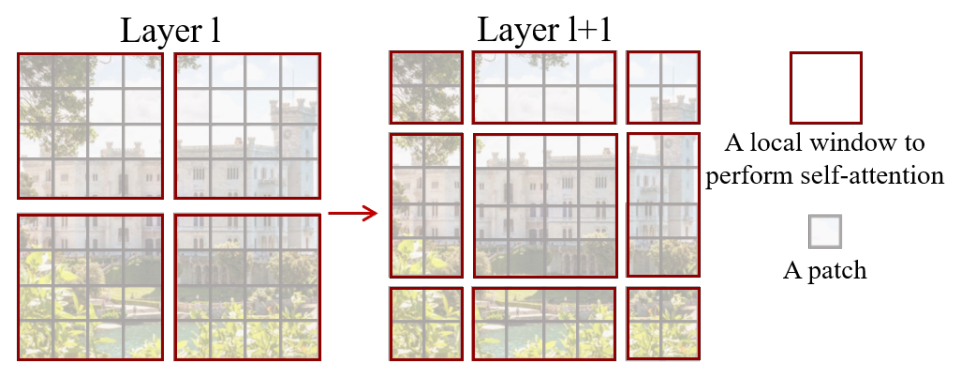

# Vision Transformers {#sec-vit}


## Motivation: From CNNs to Transformers

**The Paradigm Shift**: Transformers, originally designed for sequence modeling in NLP, have proven equally powerful for vision. Unlike CNNs with hard-coded locality biases, transformers learn spatial relationships through self-attention.

**Why Consider Transformers for Vision?**

**CNN Limitations**:

1. **Fixed receptive fields**: Even with dilated convolutions, receptive field growth is limited
2. **Local bias**: Strong inductive bias may hurt when global context matters
3. **Architecture complexity**: Different designs for different tasks

**Transformer Advantages**:

1. **Global receptive field**: Every patch can attend to all others (layer 1 onward)
2. **Architecture Flexibility**: Same architecture across modalities (vision, language, multimodal)
3. **Scalability**: Performance improves predictably with data and model size

**The Trade-off**:  

- **Transformers**: Data-hungry, computationally expensive, but better at scale
- **CNNs**: Sample-efficient (strong inductive biases), faster, better for small datasets

**Interview Context**: Companies like OpenAI (CLIP, DALL-E), Google (ViT, Imagen), Meta (DINOv2, SAM) have invested heavily in vision transformers. Understanding when to use transformers vs. CNNs is critical for system design interviews.

---

## Vision Transformer (ViT, 2020)

**Core Idea**: Apply standard Transformer directly to images by treating them as sequences of patches.

### Architecture Overview

![The Vision Transformer. The image is split into fixed-size patches, linearly projected, prepended with a learnable $[\text{CLS}]$ embedding, summed with position embeddings, and fed to a standard Transformer encoder; an MLP head on the $[\text{CLS}]$ output predicts the class. *Source: Dosovitskiy et al., "An Image is Worth 16x16 Words" (2020), Figure 1.*](/images/vision-transformers/vit_architecture.png){#fig-vit width=75%}

**Intuition**: treat an image as a sentence of "16×16 words". Cut it into patches, embed each patch as a token, and feed the token sequence to a standard Transformer encoder. Running example: a $224 \times 224$ image with $P = 16$ gives $N = 196$ patches; with $D = 768$ the encoder sees a $197 \times 768$ sequence (196 patches + 1 class token).

**1. Patch embedding.** Flatten each $P \times P \times 3$ patch into a vector $\mathbf{x}_i \in \mathbb{R}^{3P^2}$, project it with a shared linear map $\mathbf{E} \in \mathbb{R}^{D \times 3P^2}$, prepend a learnable class token, and add learnable position embeddings:
$$\mathbf{z}^{(0)} = [\mathbf{z}_{\text{cls}};\; \mathbf{E}\mathbf{x}_1;\; \ldots;\; \mathbf{E}\mathbf{x}_N] + \mathbf{E}_{\text{pos}}, \qquad N = \frac{HW}{P^2}, \quad \mathbf{E}_{\text{pos}} \in \mathbb{R}^{(N+1) \times D}$$
Attention is permutation-invariant, so the position embeddings are the only thing telling the model where each patch came from (ViT learns them; no 2D structure is built in).

**2. Transformer encoder.** $L$ identical blocks, each a residual multi-head self-attention (MSA) layer followed by a residual MLP, with LayerNorm applied *before* each (pre-norm):
$$\mathbf{z}'_\ell = \text{MSA}\big(\text{LN}(\mathbf{z}_{\ell-1})\big) + \mathbf{z}_{\ell-1}, \qquad \mathbf{z}_\ell = \text{MLP}\big(\text{LN}(\mathbf{z}'_\ell)\big) + \mathbf{z}'_\ell$$
- **MSA** is the standard Transformer attention: per head, $\text{softmax}\big(\mathbf{Q}\mathbf{K}^\top/\sqrt{d}\big)\mathbf{V}$ with $d = D/h$; the head outputs are concatenated and projected. Every patch can attend to every other patch from the first layer on.
- **MLP**: $\mathbf{W}_2\,\text{GELU}(\mathbf{W}_1\mathbf{z})$, with a $4\times$ hidden expansion ($D \to 4D \to D$), applied to each token independently.

**3. Classification head.** The final class-token state is normalized and mapped to class logits:
$$\mathbf{y} = \text{softmax}\big(\mathbf{W}_{\text{head}}\,\text{LN}(\mathbf{z}_0^{(L)})\big)$$
The class token has no image content of its own, so it acts as a learned "summary slot" that gathers global information through attention (as BERT's $[\text{CLS}]$ does). Global average pooling over the patch tokens works about as well.

::: {.callout-note collapse="true" title="Exercise: implement ViT (patch embedding and forward pass)"}
Interviewers often ask for the patch embedding in particular. Fill in the `...` gaps, then open the solution.

```python
class PatchEmbed(nn.Module):
    def __init__(self, img_size=224, patch_size=16, in_chans=3, embed_dim=768):
        super().__init__()
        self.num_patches = (img_size // patch_size) ** 2
        self.proj = ...   # one layer that patches AND projects. Hint: kernel_size = stride = patch_size

    def forward(self, x):
        # x: (B, 3, H, W)
        x = self.proj(x)   # (B, D, H/P, W/P)
        x = ...            # flatten the two spatial dims -> (B, D, N)
        x = ...            # -> (B, N, D)
        return x

# VisionTransformer.forward
def forward(self, x):
    B = x.shape[0]
    x = self.patch_embed(x)                        # (B, N, D)
    cls_tokens = ...                               # expand the CLS token to the batch: (B, 1, D)
    x = ...                                        # prepend it: (B, N+1, D)
    x = ...                                        # add position embeddings
    for block in self.blocks:
        x = block(x)
    x = self.norm(x)
    return ...                                     # classify from the CLS token
```

::: {.callout-tip collapse="true" title="Show solution: ViT"}
```python
import torch
import torch.nn as nn


class PatchEmbed(nn.Module):
    def __init__(self, img_size=224, patch_size=16, in_chans=3, embed_dim=768):
        super().__init__()
        self.num_patches = (img_size // patch_size) ** 2
        # Conv2d with kernel = stride = patch_size does patching + projection in one op
        self.proj = nn.Conv2d(in_chans, embed_dim,
                              kernel_size=patch_size, stride=patch_size)

    def forward(self, x):
        # x: (B, 3, H, W)
        x = self.proj(x)         # (B, D, H/P, W/P)
        x = x.flatten(2)         # (B, D, N)
        x = x.transpose(1, 2)    # (B, N, D)
        return x


class TransformerBlock(nn.Module):
    def __init__(self, dim, num_heads, mlp_ratio=4.0):
        super().__init__()
        self.norm1 = nn.LayerNorm(dim)
        self.attn = nn.MultiheadAttention(dim, num_heads, batch_first=True)
        self.norm2 = nn.LayerNorm(dim)
        self.mlp = nn.Sequential(
            nn.Linear(dim, int(dim * mlp_ratio)),
            nn.GELU(),
            nn.Linear(int(dim * mlp_ratio), dim),
        )

    def forward(self, x):
        h = self.norm1(x)
        x = x + self.attn(h, h, h)[0]      # self-attention with residual
        x = x + self.mlp(self.norm2(x))    # MLP with residual
        return x


class VisionTransformer(nn.Module):
    def __init__(self, img_size=224, patch_size=16, num_classes=1000,
                 embed_dim=768, depth=12, num_heads=12, mlp_ratio=4.0):
        super().__init__()
        self.patch_embed = PatchEmbed(img_size, patch_size, 3, embed_dim)
        num_patches = self.patch_embed.num_patches

        # Learnable CLS token and position embeddings
        self.cls_token = nn.Parameter(torch.zeros(1, 1, embed_dim))
        self.pos_embed = nn.Parameter(torch.zeros(1, num_patches + 1, embed_dim))
        nn.init.trunc_normal_(self.pos_embed, std=0.02)
        nn.init.trunc_normal_(self.cls_token, std=0.02)

        self.blocks = nn.ModuleList([
            TransformerBlock(embed_dim, num_heads, mlp_ratio) for _ in range(depth)
        ])
        self.norm = nn.LayerNorm(embed_dim)
        self.head = nn.Linear(embed_dim, num_classes)

    def forward(self, x):
        B = x.shape[0]
        x = self.patch_embed(x)                          # (B, N, D)
        cls_tokens = self.cls_token.expand(B, -1, -1)    # (B, 1, D)
        x = torch.cat([cls_tokens, x], dim=1)            # (B, N+1, D)
        x = x + self.pos_embed                           # add position embeddings
        for block in self.blocks:
            x = block(x)
        x = self.norm(x)
        return self.head(x[:, 0])                        # classify from the CLS token
```

- A `Conv2d` with kernel = stride = patch size is exactly "flatten each patch, then apply a shared linear layer", in one efficient op.
- Pre-LayerNorm (norm *before* attention/MLP) trains more stably than post-norm.
- The CLS token and position embeddings are learnable parameters, initialized with small random values.
:::
:::

---

### ViT Variants

| Model | Layers $L$ | Dim $D$ | Heads $H$ | Params | ImageNet (pre-trained on JFT-300M) |
|---------------|-----------|---------|-----------|--------|----------------------------------|
| **ViT-Base/16**  | 12 | 768    | 12       |  86M     |  84.2% |
| **ViT-Large/16** | 24 | 1024   | 16       | 307M     |  85.2% |
| **ViT-Huge/14**  | 32 | 1280   | 16       | 632M     |  88.5% |

**/16 or /14** denotes patch size $P$.

---

### Computational Complexity

**Self-Attention**: $O(N^2 \cdot D)$ per layer, where $N = (H/P)^2$ patches.  

**Convolution Layer**: $O(H \cdot W \cdot C^2)$ where $C$ is channel count


**Practical Implication**: ViT struggles with high-resolution images (e.g., 1024×1024).  
Whereas CNNs scale linearly with image resolution, **ViT scale quadratically** ($O(N^2)$ complexity).

---

### Training Requirements and Performance

**The Data Hunger Problem**:

| Pre-training Dataset | ImageNet-1K Accuracy (ViT-Large/16) |
|---------------------|-------------------------------------|
| ImageNet-1K (1.3M) | 76.5% **(worse than ResNet-152)**|
| ImageNet-21K (14M) | 85.3% |
| JFT-300M (300M) | 88.4% |


**Why?**

- **No inductive bias**: CNNs encode locality and translation equivariance; but
 ViT need to learn spatial relationships from scratch via attention - with enough data, this flexibility becomes an advantage.
- **Over-parameterized**: 307M parameters for ViT-Large.

**Transfer Learning Sweet Spot**:

- Pre-train on large dataset (ImageNet-21K or JFT)
- Fine-tune on downstream task → often outperforms CNNs

---

**Interview Insights**:

**Q: "Why does ViT need so much data?"**
**A**: CNNs have built-in inductive biases (locality, translation equivariance). ViT has none—must learn spatial relationships from data. With enough data, this flexibility becomes an advantage (learns task-specific patterns).

**Q: "When to use ViT over CNN?"**
**A**: 
- **Use ViT**: Large pre-trained models available, downstream task has sufficient data, need for global context (medical imaging, satellite)
- **Use CNN**: Limited data, real-time inference (lower FLOPs), well-understood architectures

**Q: "How to make ViT more efficient?"**
**A**:
 
1. Hierarchical architectures (Swin)
2. Linear attention approximations
3. Smaller patch sizes initially (higher resolution early, then merge)
4. Hybrid CNN-Transformer (CNN stem + Transformer)

---


## DeiT: Data-Efficient Training (2021)

**Problem**: ViT requires very large training datasets s.a. ImageNet-21K (14M images) or JFT (300M).

**Solution**: Knowledge distillation enables training on ImageNet-1K only.  

**Architecture:**

Add **distillation token** $\mathbf{z}_{\text{dist}}$ alongside $[\text{CLS}]$ to a total of $N+2$ tokens:

$$\mathbf{z}^{(0)} = [\mathbf{z}_{\text{cls}}; \mathbf{z}_{\text{dist}}; \mathbf{z}_1^{(0)}; \ldots; \mathbf{z}_N^{(0)}] + \mathbf{E}_{\text{pos}}$$

Consider two classification heads:

- $\mathbf{y}_{\text{cls}} = \text{softmax}(\mathbf{W}_{\text{cls}} \mathbf{z}_0^{(L)})$ — standard prediction
- $\mathbf{y}_{\text{dist}} = \text{softmax}(\mathbf{W}_{\text{dist}} \mathbf{z}_1^{(L)})$ — distillation prediction

{#fig-deit width=35%}

**Loss**:
$$\mathcal{L} = \mathcal{L}_{\text{CE}}(y, \hat{y}_{\text{cls}}) + \alpha \mathcal{L}_{\text{CE}}(y, \hat{y}_{\text{dist}}) + \beta \mathcal{L}_{\text{KD}}(y_{\text{teacher}}, \hat{y}_{\text{dist}})$$

where $\mathcal{L}_{\text{KD}} = \text{KL}\left(\text{softmax}(y_{\text{teacher}}/T) \| 
\text{softmax}(y_{\text{dist}}/T)\right)$  is the **Knowledge Distillation Loss** 
(Hinton et al., 2015),
 with $T$ the temperature parameter, typically $T=3$ for softer distributions.


**Key Findings**:

- CNN teacher (RegNetY-16GF) works better than Transformer teacher
- Achieves 81.8% on ImageNet-1K without external pre-training
- Inference: Can use $(\hat{y}_{\text{cls}} + \hat{y}_{\text{dist}})/2$ for best performance

**Impact**: Democratized ViT training—no need for web-scale datasets.


---

## CvT: Convolutional Vision Transformer (2021)

**Idea**: Combine the transformer's strengths (self-attention, global context) with the CNN's (local receptive fields, parameter sharing, spatial subsampling) by putting convolutions *inside* the transformer:

1. **Convolutional token embedding**: Each stage starts with a strided convolution that overlaps neighboring patches and reduces spatial resolution, giving a hierarchical, multi-stage design.
2. **Convolutional projection**: Queries, keys and values come from depthwise-separable convolutions over the token map instead of per-token linear layers, so each token already mixes in its neighbors. Strided projections for $\mathbf{K},\mathbf{V}$ also shorten the attention sequence.

Since convolution encodes position implicitly, CvT drops explicit positional embeddings.

{#fig-cvt width=90%}

---

## Swin Transformer (2021)

**Motivation**: ViT's $O(N^2)$ complexity doesn't scale to:


- High-resolution images (detection, segmentation need 800×800+)
- Dense prediction tasks (every pixel needs attention)

**Solution**: Hierarchical architecture with **local windowed attention** + **shifted windows** for global receptive field.

{#fig-swin-hier width=60%}

---

### Key Mechanisms


**1. Window Attention (W-MSA)**:

- Partition into $M \times M$ non-overlapping windows (typically $M=7$)
- Self-attention within each window only
- Complexity: $O(hw \cdot M^2)$ — **linear in image size**

**2. Shifted Window Attention (SW-MSA)**:

- Alternate between regular and shifted ($M/2$ offset) window partitions
- Enables cross-window communication
- Implemented efficiently via cyclic shift + masking

{#fig-swin-shift width=65%}

**3. Patch Merging** (like CNN pooling):

- Concatenate 2×2 neighbors (4C channels)
- Linear projection: $4C → 2C$
- Result: $4×$ fewer tokens, $2×$ channels

**Architecture** (4 Stages - analogous to CNN feature pyramid):

{#fig-swin-arch}

```
Input (224×224×3)
  ↓ Patch Partition (4×4) → (56×56, 96 channels)
  ↓ Stage 1: 2× Swin Blocks (56×56, 96 ch)
  ↓ Patch Merging → (28×28, 192 ch)
  ↓ Stage 2: 2× Swin Blocks (28×28, 192 ch)
  ↓ Patch Merging → (14×14, 384 ch)
  ↓ Stage 3: 6× Swin Blocks (14×14, 384 ch)
  ↓ Patch Merging → (7×7, 768 ch)
  ↓ Stage 4: 2× Swin Blocks (7×7, 768 ch)
  ↓ Classification Head
```

**Key Properties**:

- Spatial resolution decreases (like CNN pooling)
- Channel count increases (compensation)
- Produces multi-scale features (compatible with FPN for detection)

---

**Performance**:

| Task | Metric | ResNet-50 | ViT-Base | Swin-Tiny | Swin-Base |
|------|--------|-----------|----------|-----------|-----------|
| ImageNet | Top-1 | 76.2% | 77.9% | 81.3% | 83.5% |
| COCO Det | Box AP | 38.0 | - | 42.2 | 46.9 |
| COCO Det | Mask AP | 34.4 | - | 39.1 | 42.3 |

(Detection and Segmentation performed with Mask R-CNN, using each of the backbones above)


**Why Swin Excels**:

- Local windows → retains fine spatial details
- Linear complexity → handles high resolution
- Hierarchical features → compatible with FPN

---

**Interview Insights**:

**Q: "Swin vs. ViT trade-offs?"**  
**A**:

- **Swin**: Efficient ($O(N)$), hierarchical features, better for dense tasks  
- **ViT**: Simpler, global attention from layer 1, better for large-scale pre-training

**Q: "Why shifted windows instead of overlapping windows?"**  
**A**: Overlapping windows would increase computation (more tokens per window). Shifting provides cross-window communication with zero overhead via cyclic shift trick.

**Q: "Can Swin replace CNNs entirely?"**   
**A**: In many cases, yes—especially for detection/segmentation. CNNs still win for:
 
- Very small datasets (better inductive bias)  
- Real-time inference (lower latency)  
- Hardware without optimized attention kernels


---

::: {.callout-note collapse="true" title="Exercise: implement window partitioning and the shifted-window block"}
Swin's central trick is computing attention inside local windows. Fill in `window_partition` (reshape and permute, no loops) and the cyclic shift, then open the solution.

```python
def window_partition(x, ws):
    # x: (B, H, W, C)  ->  (B * num_windows, ws, ws, C)
    B, H, W, C = x.shape
    x = ...   # view as (B, H/ws, ws, W/ws, ws, C)
    x = ...   # permute so the two window-grid axes are adjacent: (B, H/ws, W/ws, ws, ws, C)
    return ... # merge the leading axes into (B * num_windows, ws, ws, C)

# Inside the block: shifted windows (SW-MSA)
if self.shift > 0:
    x = ...   # cyclic shift of the feature map by -shift in both spatial dims
... # attention inside windows ...
if self.shift > 0:
    x = ...   # undo the shift
```

::: {.callout-tip collapse="true" title="Show solution: Swin"}
```python
import torch
import torch.nn as nn


def window_partition(x, ws):
    # x: (B, H, W, C) -> (B * num_windows, ws, ws, C)
    B, H, W, C = x.shape
    x = x.view(B, H // ws, ws, W // ws, ws, C)
    x = x.permute(0, 1, 3, 2, 4, 5).contiguous()
    return x.view(-1, ws, ws, C)


def window_reverse(windows, ws, H, W):
    # windows: (B * num_windows, ws, ws, C) -> (B, H, W, C)
    B = windows.shape[0] // ((H // ws) * (W // ws))
    x = windows.view(B, H // ws, W // ws, ws, ws, -1)
    x = x.permute(0, 1, 3, 2, 4, 5).contiguous()
    return x.view(B, H, W, -1)


class SwinBlock(nn.Module):
    """Simplified: no relative position bias, and no attention mask for the
    wrapped-around regions of shifted windows (both are in the original)."""

    def __init__(self, dim, num_heads, window_size=7, shift_size=0):
        super().__init__()
        self.ws, self.shift = window_size, shift_size
        self.norm1 = nn.LayerNorm(dim)
        self.attn = nn.MultiheadAttention(dim, num_heads, batch_first=True)
        self.norm2 = nn.LayerNorm(dim)
        self.mlp = nn.Sequential(nn.Linear(dim, 4 * dim), nn.GELU(), nn.Linear(4 * dim, dim))

    def forward(self, x, H, W):
        # x: (B, H*W, C)
        B, L, C = x.shape
        shortcut = x
        x = self.norm1(x).view(B, H, W, C)

        # Cyclic shift so that shifted windows can be handled as regular ones
        if self.shift > 0:
            x = torch.roll(x, shifts=(-self.shift, -self.shift), dims=(1, 2))

        # Self-attention inside each window only
        w = window_partition(x, self.ws).view(-1, self.ws * self.ws, C)
        w = self.attn(w, w, w)[0]
        x = window_reverse(w.view(-1, self.ws, self.ws, C), self.ws, H, W)

        # Undo the cyclic shift
        if self.shift > 0:
            x = torch.roll(x, shifts=(self.shift, self.shift), dims=(1, 2))

        x = shortcut + x.reshape(B, H * W, C)       # residual
        return x + self.mlp(self.norm2(x))          # MLP with residual
```

- `window_partition` and `window_reverse` are pure reshapes/permutes: windows become extra batch entries, so attention costs $O(M^2)$ per window and $O(hw \cdot M^2)$ overall.
- `torch.roll` implements the shift. The cyclic shift keeps the number of windows constant, avoiding the extra windows (and padding) a literal shifted grid would need.
- Simplified for readability: the original also adds a relative position bias to the attention logits, and masks attention between regions that were not adjacent before the roll.
:::
:::


---

## From Backbones to Dense Prediction

ViT and DeiT are classification architectures; Swin is the first design built to serve as a general-purpose **backbone**. Detection and segmentation heads on top of CNN or transformer backbones—including transformer-native detectors such as DETR and Deformable DETR—are covered in @sec-detection, and segmentation—including the SAM foundation models built on a ViT encoder—in @sec-segmentation.

---

##  Summary and Interview Preparation

### Core Concepts Checklist

**Vision Transformers**:

- [ ] Patch embedding and positional encoding
- [ ] Self-attention complexity: $O(N^2 \cdot D)$
- [ ] Why ViT needs large datasets (no inductive bias)
- [ ] When to use ViT vs. CNN

**DeiT**:

- [ ] Knowledge distillation with hard and soft labels
- [ ] Distillation token mechanism
- [ ] Training ViT on ImageNet-1K

**Swin Transformer**:

- [ ] Window-based vs. global attention
- [ ] Shifted windows for cross-window communication
- [ ] Patch merging for hierarchical features
- [ ] Complexity: $O(N)$ vs. ViT's $O(N^2)$

**CvT**:

- [ ] Convolutional token embedding and convolutional Q/K/V projection
- [ ] Why convolutions remove the need for positional embeddings

### Common Interview Questions

1. **"Why does ViT need more data than ResNet?"**
   - No built-in locality/translation equivariance → must learn from data

2. **"How does Swin achieve linear complexity?"**
   - Window attention: $O(M^2)$ per window, $O(hw \cdot M^2)$ total vs. ViT's $O((hw)^2)$
   - Shifted windows maintain global receptive field

3. **"When to use transformer vs. CNN backbone?"**
   - **Transformer**: Large pre-trained models available, global context critical
   - **CNN**: Limited data, real-time constraints, edge deployment

*Detection and segmentation questions (DETR, Deformable DETR, Mask2Former, SAM) are in @sec-detection and @sec-segmentation.*

### Interview Preparation Tips

- **Complexity analysis**: ViT: $O(N^2)$, Swin: $O(N)$ (window size $M$ is a constant)
- **Architecture comparisons**: Multi-dimensional trade-offs (accuracy, speed, memory, data)
- **Implementation details**: Understand the shifted window trick (cyclic shift + masking) and patch merging
- **Recent advances**: DINOv2, Depth Anything (and SAM 2 in @sec-segmentation)
- **Company context**: Meta (SAM, DINO), Google (ViT, Swin), OpenAI (CLIP, and DALL-E which uses ViT), Tesla (bird’s eye view BEV transformers)

### Further Reading
- **Transformer Papers**: [ViT](https://arxiv.org/abs/2010.11929) • [DeiT](https://arxiv.org/abs/2012.12877) • [CvT](https://arxiv.org/abs/2103.15808) • [Swin](https://arxiv.org/abs/2103.14030)
- **Survey**: [Transformers in Vision: A Survey](https://arxiv.org/abs/2101.01169)

---

This completes the architecture side of Vision Transformers. The evolution—from pure self-attention (ViT), to data-efficient training (DeiT), to convolution-augmented (CvT) and hierarchical efficient designs (Swin)—produced backbones that now serve classification and dense prediction alike. Next we put CNN and transformer backbones to work on detection and segmentation.
