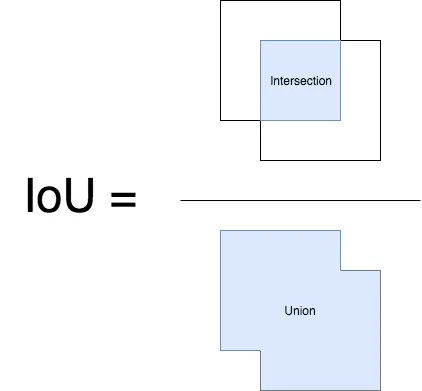
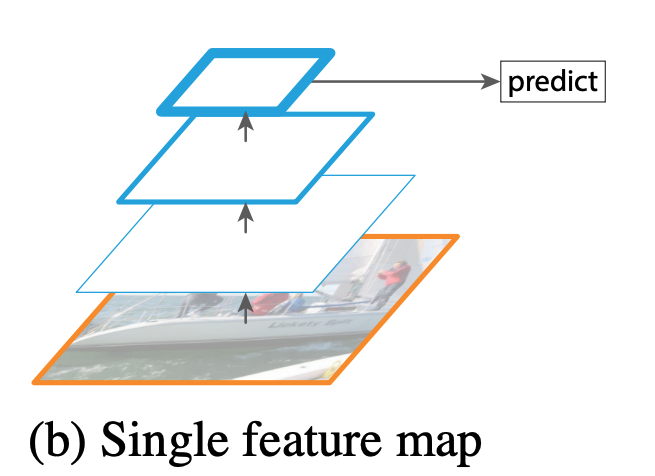
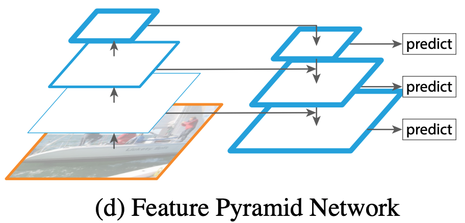
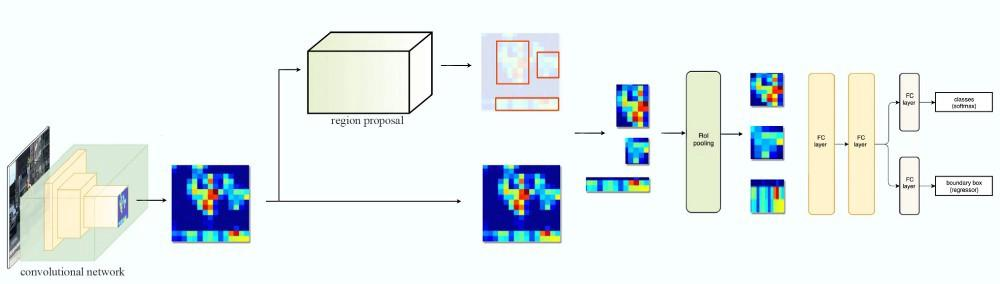
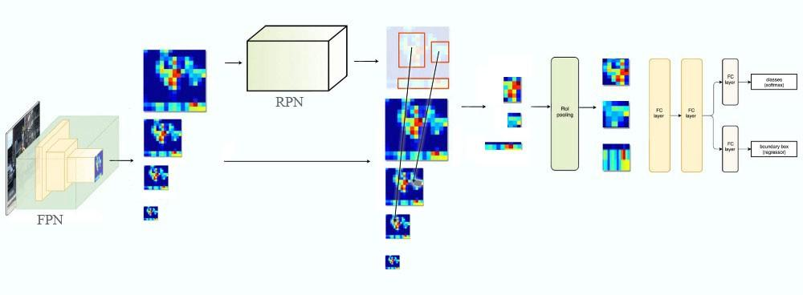

# Object Detection {#sec-detection}

Detection takes the backbones of the previous chapters (CNNs and Vision Transformers) and adds task-specific machinery on top. Almost every model in this chapter follows the same **backbone → neck → head** pattern: a backbone extracts features, a neck (e.g., a feature pyramid) fuses them across scales, and a head predicts boxes and classes. We start with the classical detectors (two-stage, single-stage, NMS, and the multi-scale FPN neck) and close with transformer-based detectors, which drop much of the hand-designed machinery. Dense, pixel-level prediction—semantic, instance, and panoptic segmentation—is the subject of the next chapter (@sec-segmentation), which builds directly on the detectors here (Mask R-CNN extends Faster R-CNN; Mask2Former and SAM 3 build on DETR).

## Object Detection

**Task Definition**: Given image $\mathbf{I}$, output set of bounding boxes $\{(x, y, w, h, c, p)\}$ where:
- $(x,y)$ = box center
- $(w,h)$ = width, height
- $c \in \{1, \ldots, C\}$ = object class
- $p \in [0,1]$ = confidence score

**Challenges**:
1. **Multiple objects**: Variable number per image
2. **Scale variation**: Objects from 10×10 to 500×500 pixels
3. **Occlusion**: Partially hidden objects
4. **Dense overlapping predictions**: Must suppress duplicates

**Paradigms**:
- **Two-Stage** (R-CNN family): Propose regions → classify/refine
- **Single-Stage** (YOLO, SSD): Directly predict boxes at multiple scales
- **Set Prediction** (DETR): Transformer predicts the box set directly, no anchors or NMS (see @sec-detr)

**A naive approach** is to slide a window over the image and classify each crop. It is slow and inaccurate: objects rarely fit any of the fixed windows. CNN detectors instead propose boxes ("anchors") directly on feature maps.

### Box Overlap: Intersection over Union (IoU)

Box overlap is the common currency of detection—it defines positive/negative anchors, duplicate suppression (NMS), and evaluation:

$$\text{IoU}(A, B) = \frac{|A \cap B|}{|A \cup B|}$$

{#fig-iou width=30%}

---

### Two-Stage Detectors: Faster R-CNN {#sec-faster-rcnn}

**Architecture Overview**:

{#fig-faster-rcnn width=60%}

```
Image → CNN Backbone → Feature Maps 
                         ↓
                    [Stage 1: RPN]
                         ↓
                Region Proposals (~2000)
                         ↓
                    [ROI Pooling]
                         ↓
                   [Stage 2: R-CNN]
                         ↓
                (Class, Box Refinement)
```

#### Region Proposal Network (RPN)

**Purpose**: Generate ~2000 candidate object locations (proposals).

**Mechanism**:
1. Slide 3×3 conv over feature map
2. At each location, predict $k$ **anchor boxes** (different scales/ratios)
   - Scales: {128², 256², 512²}
   - Ratios: {1:1, 1:2, 2:1}
   - Total: $k = 9$ anchors per location

3. For each anchor, predict:
   - **Objectness**: $p_{\text{obj}} \in [0,1]$ (object vs. background)
   - **Box offsets**: $(t_x, t_y, t_w, t_h)$ to refine anchor

**Anchor Box Parametrization**:
Given anchor $(x_a, y_a, w_a, h_a)$, predicted box:
$$x = x_a + w_a \cdot t_x, \quad y = y_a + h_a \cdot t_y$$
$$w = w_a \cdot \exp(t_w), \quad h = h_a \cdot \exp(t_h)$$

**Loss Function**:
$$\mathcal{L}_{\text{RPN}} = \frac{1}{N_{\text{cls}}} \sum_i \mathcal{L}_{\text{cls}}(p_i, p_i^*) + \lambda \frac{1}{N_{\text{reg}}} \sum_i p_i^* \mathcal{L}_{\text{reg}}(\mathbf{t}_i, \mathbf{t}_i^*)$$

where:
- $\mathcal{L}_{\text{cls}}$ = binary cross-entropy (object vs. not)
- $\mathcal{L}_{\text{reg}}$ = smooth L1 loss: $\text{smooth}_{L1}(x) = \begin{cases} 0.5x^2 & |x| < 1 \\ |x| - 0.5 & \text{otherwise} \end{cases}$
- $p_i^* \in \{0,1\}$ = ground truth objectness
- Regression loss only for positive anchors ($p_i^* = 1$)

**Label Assignment**:
- **Positive**: IoU > 0.7 with any ground truth, or highest IoU for a GT
- **Negative**: IoU < 0.3 with all ground truths
- **Ignore**: 0.3 ≤ IoU ≤ 0.7 (don't contribute to loss)

**Training Details**:
- Sample 256 anchors per image (128 positive, 128 negative)
- Positive samples often scarce → pad with negatives
- Cross-boundary anchors ignored during training

---

#### ROI Pooling

**Purpose**: Extract fixed-size features from variable-size proposals.

**Algorithm**:
1. Project proposal onto feature map (divide coords by network stride)
2. Divide region into $H \times W$ grid (e.g., 7×7)
3. Max-pool within each grid cell

![RoI pooling on an $8\times 8$ activation map. The region proposal is projected onto the feature map, divided into a $2\times 2$ grid of sections (here), and each section is max-pooled, producing a fixed-size output regardless of proposal size. *Source: Ochman (2025)* [@ochman2025roi].](/images/object-detection/roi_pooling_example.png){#fig-roi-pooling width=80%}

**Example**: 
- Proposal: 145×200 pixels at input
- Feature map stride: 16 → proposal is 9.06×12.5 feature map cells
- ROI Pooling: divide into 7×7 → each cell ~1.3×1.8 features → max-pool

**Problem - Misalignment**: Quantization (rounding coords) causes misalignment, hurting segmentation.

**Solution - ROI Align** (Mask R-CNN):
- Use bilinear interpolation instead of rounding
- Sample 4 points per grid cell, interpolate, then max-pool
- **Result**: Better localization for masks

---

#### R-CNN Head (Stage 2)

**Input**: Fixed 7×7×512 features from ROI Pooling

**Architecture**:
```
ROI Features → FC(4096) → ReLU → Dropout
             → FC(4096) → ReLU → Dropout
             → Split:
                 ├─ Classification: FC(C+1)  [C classes + background]
                 └─ Box Regression: FC(4×C)  [per-class box refinement]
```

**Loss Function**:
$$\mathcal{L} = \mathcal{L}_{\text{cls}}(c, c^*) + \lambda [c^* > 0] \mathcal{L}_{\text{box}}(\mathbf{t}^{c^*}, \mathbf{t}^{c^*}_{\text{gt}})$$

- Classification: multi-class cross-entropy
- Regression: smooth L1, only for non-background classes
- $c^* = 0$ is background → no box loss

**Training Strategy** (4-Step Alternating):
1. Train RPN alone
2. Train R-CNN with frozen RPN proposals
3. Fine-tune RPN with R-CNN backbone frozen
4. Fine-tune R-CNN head

Modern implementations use **approximate joint training** (single-stage, more stable).

---

**Faster R-CNN Summary**:
- **Pros**: High accuracy, flexible (any CNN backbone), strong for small objects
- **Cons**: Slow (two-stage), complex training, many hyperparameters
- **Use When**: Accuracy is critical (autonomous vehicles, medical imaging)
- **Avoid When**: Real-time constraint (use YOLO instead)

---

### Single-Stage Detectors: YOLO

**Philosophy**: "You Only Look Once"—predict all boxes in one forward pass.

**YOLO Architecture** (YOLOv3 as example):
```
Image → DarkNet-53 Backbone 
       → Feature Pyramid (3 scales)
       → Dense Predictions
```

**Grid-Based Prediction**:
1. Divide image into $S \times S$ grid (e.g., 13×13)
2. Each grid cell predicts $B$ bounding boxes (e.g., $B=3$)
3. For each box, predict:
   - Box coordinates: $(t_x, t_y, t_w, t_h)$
   - Objectness: $p_{\text{obj}}$
   - Class probabilities: $(p_1, \ldots, p_C)$

{#fig-yolo width=55%}

**Total predictions**: $S \times S \times B \times (5 + C)$ values

For $S=13$, $B=3$, $C=80$ (COCO): $13 \times 13 \times 3 \times 85 = 43{,}095$ predictions

**Box Decoding** (relative to grid cell):
$$b_x = \sigma(t_x) + c_x, \quad b_y = \sigma(t_y) + c_y$$
$$b_w = p_w \cdot e^{t_w}, \quad b_h = p_h \cdot e^{t_h}$$

where $(c_x, c_y)$ = grid cell offset, $(p_w, p_h)$ = anchor dimensions.

**Loss Function** (YOLOv3):
$$\mathcal{L} = \lambda_{\text{coord}} \sum_{i,j} \mathbb{1}_{ij}^{\text{obj}} \left[(t_x - \hat{t}_x)^2 + (t_y - \hat{t}_y)^2 + (t_w - \hat{t}_w)^2 + (t_h - \hat{t}_h)^2\right]$$
$$+ \sum_{i,j} \mathbb{1}_{ij}^{\text{obj}} \text{BCE}(C_{ij}, \hat{C}_{ij})$$
$$+ \lambda_{\text{noobj}} \sum_{i,j} \mathbb{1}_{ij}^{\text{noobj}} \text{BCE}(C_{ij}, \hat{C}_{ij})$$
$$+ \sum_{i,j} \mathbb{1}_{ij}^{\text{obj}} \sum_{c \in \text{classes}} \text{BCE}(p_{ij}(c), \hat{p}_{ij}(c))$$

where:
- $\mathbb{1}_{ij}^{\text{obj}} = 1$ if box $j$ in cell $i$ is responsible for object
- $\lambda_{\text{coord}} = 5$, $\lambda_{\text{noobj}} = 0.5$ (balance localization vs. classification)
- BCE = binary cross-entropy

**Key Insight**: 
- **Coordinate loss**: Only when cell contains object
- **No-object loss**: Down-weighted (most cells are background)
- **Class loss**: Only for cells with objects

**Multi-Scale Predictions** (YOLOv3+):
- Predict at 3 scales: 13×13, 26×26, 52×52
- Small objects → fine grid (52×52)
- Large objects → coarse grid (13×13)
- Uses Feature Pyramid Network (FPN) structure

**YOLO Advantages**:
- **Speed**: 30-60 FPS (real-time)
- **Global context**: Sees entire image (vs. RPN local proposals)
- **Fewer false positives** on background

**YOLO Disadvantages**:
- **Small objects**: Struggles when multiple objects in same grid cell
- **Unusual aspect ratios**: Fixed anchor boxes may not fit well
- **Localization**: Less precise than two-stage detectors

**Interview Insight**: "YOLO vs. Faster R-CNN?" Answer framework:
- **Speed**: YOLO 10× faster (single-stage)
- **Accuracy**: Faster R-CNN slight edge on COCO mAP
- **Small objects**: Faster R-CNN better (RPN + multi-scale RoIs)
- **Deployment**: YOLO for real-time, Faster R-CNN when accuracy critical

---

### Non-Maximum Suppression (NMS)

**Problem**: Detectors generate many overlapping boxes for same object.

**Algorithm**:
```python
def nms(boxes, scores, iou_threshold=0.5):
    """
    boxes: (N, 4) - [x1, y1, x2, y2]
    scores: (N,) - confidence scores
    """
    # Sort by score descending
    order = scores.argsort()[::-1]
    keep = []
    
    while len(order) > 0:
        i = order[0]
        keep.append(i)
        
        # Compute IoU with remaining boxes
        ious = compute_iou(boxes[i], boxes[order[1:]])
        
        # Keep only boxes with IoU < threshold
        order = order[1:][ious < iou_threshold]
    
    return keep

def compute_iou(box1, box2):
    """IoU between two boxes"""
    x1 = max(box1[0], box2[0])
    y1 = max(box1[1], box2[1])
    x2 = min(box1[2], box2[2])
    y2 = min(box1[3], box2[3])
    
    intersection = max(0, x2 - x1) * max(0, y2 - y1)
    area1 = (box1[2] - box1[0]) * (box1[3] - box1[1])
    area2 = (box2[2] - box2[0]) * (box2[3] - box2[1])
    union = area1 + area2 - intersection
    
    return intersection / union
```

**Complexity**: $O(N^2)$ IoU computations (can be optimized with spatial hashing)

**Threshold Selection**:
- **Low** (0.3-0.4): Aggressive suppression → fewer duplicates, may miss nearby objects
- **High** (0.6-0.7): Keep more boxes → more duplicates, better recall

**Per-Class NMS**: 
In multi-class detection, run NMS separately per class (car boxes don't suppress person boxes).

**Soft-NMS** (Bodla et al., 2017):
Instead of hard removal, decay scores based on IoU:
$$s_i = \begin{cases} s_i & \text{IoU}(\mathcal{M}, b_i) < N_t \\ s_i \cdot e^{-\frac{\text{IoU}(\mathcal{M}, b_i)^2}{\sigma}} & \text{otherwise} \end{cases}$$

where $\mathcal{M}$ is the current maximum box.

**Result**: Boxes with high IoU get down-weighted instead of removed → better recall.

---

### Multi-Scale Features: Feature Pyramid Networks {#sec-fpn}

Objects span a wide range of sizes, but a backbone's deepest feature map is semantically strong and spatially coarse—poor for small objects and for the fine detail segmentation needs. The **Feature Pyramid Network** (FPN, Lin et al., 2017) [@lin2017fpn] is a *neck* that makes every scale semantically strong. It is used by Faster/Mask R-CNN, RetinaNet, and YOLOv3+.

::: {layout-ncol=2}
{#fig-fpn-single width=70%}

{#fig-fpn-schematic width=95%}
:::

The FPN augments the bottom-up backbone (ResNet stages $C_2,\dots,C_5$) with a **top-down pathway** and **lateral connections**. Each top-down map $M_\ell$ is formed by upsampling the coarser map above it ($2\times$) and adding a $1{\times}1$-projected lateral feature from the matching bottom-up stage; a $3{\times}3$ convolution then produces the output pyramid level $P_\ell$. A shared predictor head (objectness + box) is applied to every level.

{#fig-fpn-arch width=75%}

Given the pyramid, each RoI's feature patch is taken from **the level whose scale best matches the RoI's size**. For an RoI of width $w$ and height $h$, the level is

$$
k = \Big\lfloor\, k_0 + \log_2\!\big(\sqrt{wh}\,/\,224\big)\Big\rfloor,
\qquad k_0 = 4,
$$

so larger RoIs are read off coarser (higher-$k$) maps and smaller RoIs off finer ones ($224$ is the canonical ImageNet pre-training size).

::: {layout-ncol=2}
{#fig-frcnn-single}

{#fig-frcnn-fpn}
:::

---

## Detection with Transformers

Everything above relies on hand-designed components: anchors, NMS, RoI pooling, feature pyramids. Transformer-based detectors remove most of them by casting detection as **set prediction**, and they extend naturally to segmentation (@sec-mask2former).

### DETR: Detection Transformer (2020) {#sec-detr}

**Paradigm**: Treat object detection as **direct set prediction** (no anchors, no NMS).

**Key Components**:

1. **Backbone**: Standard ResNet-50 (could be any CNN)
2. **Encoder**: Processes flattened image features, with positional encodings, using self-attention
3. **Decoder**: 100 learnable **object queries** attend to the encoder output
4. **Prediction Head**: A shared feed-forward network (FFN) maps each decoder output to (class, box) or "no object"

{#fig-detr width=95%}

**Object Queries**: 

- 100 learnable embeddings $\mathbf{q}_1, \ldots, \mathbf{q}_{100} \in \mathbb{R}^D$ initialized randomly. 
- Each of these queries can "search" for an object via cross-attention to encoder features.
- COCO images have $<100$ objects on average. Excess queries predict “no object” class

#### Training with Bipartite Matching

Ground truth has variable number of objects (1-100), predictions are fixed (100). The ground truth is padded with "no object" up to 100 (an image with 4 objects gets 96 padding entries).  
**Hungarian Algorithm** finds optimal one-to-one matching between predictions and ground truth:
$$\sigma^* = \arg\min_{\sigma} \sum_{j} \left[-\hat{p}_{c_j}(\sigma(j)) + \mathcal{L}_{\text{box}}(\hat{\mathbf{b}}_{\sigma(j)}, \mathbf{b}_j)\right]$$

**Loss** (given the optimal assignment): cross-entropy for classes plus a combination of $\ell_1$ and generalized IoU for boxes:
$$\mathcal{L} = \sum_{j} \left[-\log \hat{p}_{c_j}(\sigma^*(j)) + \lambda_{\text{L1}}\|\hat{\mathbf{b}} - \mathbf{b}\|_1 + \lambda_{\text{GIoU}} \mathcal{L}_{\text{GIoU}}\right]$$

**Key Innovation**: Set prediction with matching → **NMS unnecessary** (each object predicted once).  
This is more elegant than setting a IoU threshold for NMS, a hand-crafted heuristic.

#### Limitations and Performance

**COCO Detection AP**:

| Model | Backbone | AP | AP₅₀ | AP₇₅ |
|-------|----------|-----|------|------|
| Faster R-CNN | ResNet-50 | 37.0 | 58.1 | 40.0 |
| DETR | ResNet-50 | 40.6 | 61.1 | 43.5 |
| DETR | ResNet-101 | 42.0 | 62.4 | 44.2 |

**Advantages**:

- ✓ Simpler pipeline (no anchors, NMS)
- ✓ Better for large objects
- ✓ Easier to extend (panoptic segmentation with mask head)

**Disadvantages**:

- ✗ Slow convergence (500 epochs vs. 12 for Faster R-CNN)
- ✗ Poor small object performance (attention diffuses over large feature maps)
- ✗ High memory (encoder processes full feature map)

#### Panoptic Segmentation Extension

DETR performs panoptic segmentation by adding a **mask head** on top of the decoder outputs: for each object embedding, multi-head attention against the encoded image yields low-resolution attention maps, an FPN-style CNN upsamples them into per-object mask logits, and a pixel-wise `argmax` merges "thing" and "stuff" masks into one coherent map.

{#fig-detr-panoptic width=95%}

**Training**: Add mask loss (binary cross-entropy) to classification loss + box loss.

**Result**: DETR achieves state-of-art panoptic segmentation on COCO with minimal architecture changes.

---

### Deformable DETR (2021)

**Problem**: DETR is slow (500 epochs) and struggles with small objects.

**Solution - Deformable Attention**:

- Attend to only $K=4$ learned reference points (vs. all $N$ pixels)
- Multi-scale sampling from feature pyramid

**Standard Attention** (query $\mathbf{q}$, keys $\{\mathbf{k}_1, \ldots, \mathbf{k}_N\}$):
$$\text{Attn}(\mathbf{q}, \{\mathbf{k}_i\}_{i=1}^N) = \sum_{i=1}^N \alpha_i \mathbf{v}_i$$

where $\alpha_i = \text{softmax}\left(\frac{\mathbf{q} \cdot \mathbf{k}_i}{\sqrt{d}}\right)$.

**Deformable Attention**:  
$$\text{DeformAttn}(\mathbf{q}, \mathbf{p}_{\text{ref}}) = \sum_{k=1}^K \alpha_{i} \cdot \mathbf{x}(\mathbf{p}_{\text{ref}} + \Delta \mathbf{p}_{mk})$$

where:

- $\mathbf{p}_{\text{ref}} \in \mathbb{R}^2$ = reference point (e.g., query's current best guess)
- $\Delta \mathbf{p}_{k} \in \mathbb{R}^2$ = **learned offset** for sampling point $k$
- $\mathbf{x}(\mathbf{p})$ = feature at location $\mathbf{p}$ (bilinear interpolation if non-integer)
- $\alpha_{k}$ = attention weight (learned)

{#fig-deform-attn width=70%}

**Multi-Scale**: Sample from multiple FPN levels → better small object detection, without needing an explicit FPN.

$$\text{MSDeformAttn}(\mathbf{q}, \{\mathbf{p}_{\text{ref}}^l\}_{l=1}^L, \{\mathbf{x}^l\}_{l=1}^L) =
\mathbf{W}_m \sum_{l=1}^L \sum_{k=1}^K \alpha_{mlk} \cdot \mathbf{x}^l(\mathbf{p}_{\text{ref}}^l + \Delta \mathbf{p}_{mlk})$$

- Small objects → sample from high-res features
- Large objects → sample from low-res features
- Query learns which scales are relevant

{#fig-deform-detr width=85%}

**Complexity**:  DETR: $O(N_q \cdot N_k \cdot D)$ → **quadratic**.  
Deformable DETR: $O(N_q \cdot K \cdot D)$, where $K$ is constant → **linear**  

**Performance**:

| Model | Epochs | AP | AP_S (small) |
|-------|--------|-----|--------------|
| DETR | 500 | 40.6 | 20.5 |
| Deformable DETR | 50 | 46.2 | 28.8 |

**Key Improvements**: 10× faster training, +8.3 AP on small objects.

---

## Summary and Interview Preparation

### Core Concepts Checklist

- [ ] IoU, anchor label assignment, and NMS (per-class, soft-NMS)
- [ ] Two-stage (RPN → RoI pooling/align → heads) vs. single-stage (YOLO grid) trade-offs
- [ ] Why FPN helps small objects and how RoIs are assigned to pyramid levels
- [ ] Set prediction with Hungarian matching and object queries; why NMS is unnecessary
- [ ] Deformable attention: learned offsets, multi-scale sampling, $O(N_q K)$ complexity

### Common Interview Questions

1. **"YOLO vs. Faster R-CNN—when to use each?"**
   - YOLO: real-time, simpler; Faster R-CNN: higher accuracy, better for small objects

2. **"Why doesn't DETR need NMS?"**
   - Bipartite matching ensures one-to-one assignment → no duplicate predictions

3. **"Explain DETR's training process."**
   - Hungarian matching between the 100 predictions and the (padded) ground truth
   - Loss: classification (CE) + box ($\ell_1$ + GIoU)

4. **"Deformable DETR vs. DETR trade-offs?"**
   - 10× faster training, better small objects, slightly more complex architecture

5. **"Why does deformable attention help small objects?"**
   - Standard attention diffuses over large feature maps; deformable attention focuses on a small learned set of locations, and multi-scale sampling brings in high-resolution features.

6. **"How to implement bilinear sampling for non-integer coordinates?"**
   - PyTorch's `F.grid_sample` with `mode='bilinear'`. Also used in Spatial Transformer Networks (2015) and Deformable Convolutions (2017).

### Interview Preparation Tips

- **Architectural depth**: Know parameter counts, FLOPs for common models
- **Training dynamics**: Batch size effects, learning rate schedules, convergence
- **Trade-offs**: Accuracy vs. speed, memory vs. compute, model size vs. performance
- **Complexity analysis**: Self-attention $O(N^2)$ vs. deformable $O(K)$ with $K$ constant

### Further Reading

- [Object Detection in 20 Years](https://arxiv.org/abs/1905.05055)
- **Papers**: [Faster R-CNN](https://arxiv.org/abs/1506.01497) • [FPN](https://arxiv.org/abs/1612.03144) • [DETR](https://arxiv.org/abs/2005.12872) • [Deformable DETR](https://arxiv.org/abs/2010.04159)

The next chapter covers segmentation, from U-Net and Mask R-CNN through Mask2Former to the promptable SAM family.
