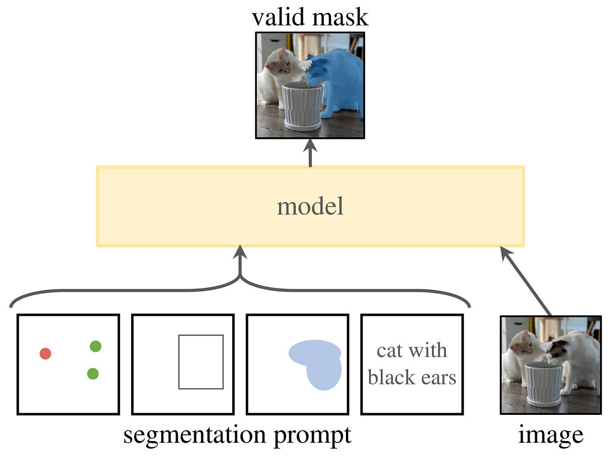
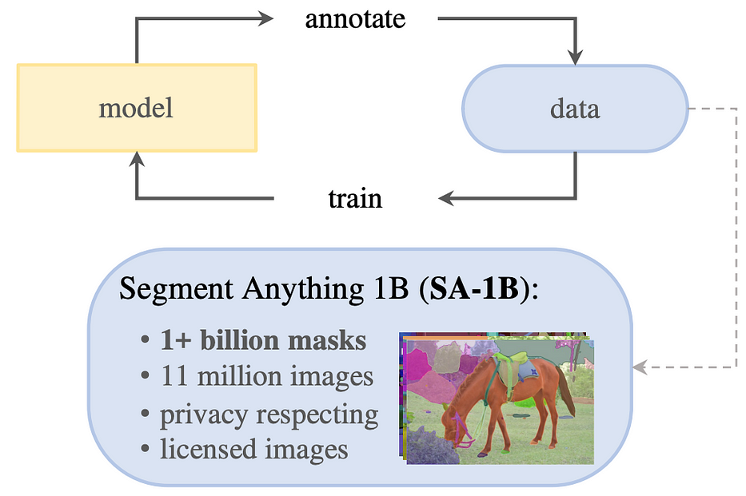

# Foundation Segmentation Models {#sec-segmentation}

Classical segmentation models are trained for a fixed label set on a fixed dataset. The **Segment Anything** (SAM) family from Meta AI instead treats segmentation as a *promptable foundation-model* problem: pre-train once on a very large mask dataset, then solve new segmentation tasks at inference time by prompting—points, boxes, masks, or text—with no task-specific fine-tuning. This chapter follows the line from the original **SAM** (@sec-sam) to its video extension **SAM 2** (@sec-sam2) and the open-vocabulary **SAM 3** (@sec-sam3). It builds on the task taxonomy and detectors of @sec-detection-and-segmentation (in particular DETR, @sec-detr) and on the ViT encoders of the Vision Transformers chapter.

## SAM: Segment Anything Model (2023) {#sec-sam}

**Segment Anything (SAM, 2023)** [@kirillov2023sam] mimics the recipe that produced foundation models in NLP: first **pre-train** a single model on a massive, generic dataset, then solve more specific downstream vision tasks through a vision analogue of **prompt engineering**.

### Pre-training task: promptable segmentation

Given an input image *and* a **segmentation prompt**, output a **valid segmentation mask** for the object the prompt refers to. The prompt carries either

- **spatial information**—foreground/background points, a box, or a coarse mask; or
- **textual information**—a free-form phrase identifying the object.

The output should be a *valid* mask even when the prompt is ambiguous.

{#fig-sam-task width=55%}

### Model architecture

To reconcile a **fine-grained image representation** with **fast, interactive** re-prompting, SAM splits computation into a heavy image encoder that runs **once per image** and lightweight modules that run **once per prompt**:

- **Image encoder**—a **Vision Transformer (ViT-H, 632M parameters)** [@dosovitskiy2021vit] pre-trained with **Masked Autoencoding (MAE)** [@he2022mae]. Input $1024\times1024$ → $64\times64\times256$ embedding, computed a single time per image.
- **Prompt encoder**—positional encodings for **points** and **boxes**; a small **convolutional network** for coarse input **masks**; a **CLIP** [@radford2021clip] **text encoder** for **free-form text**.
- **Mask decoder**—a lightweight **two-layer transformer decoder**: self-attention over prompt and mask tokens, cross-attention to the image embedding. It outputs 3 masks plus 3 IoU confidence scores.

**Ambiguity** in the referred object (does a point on a shirt mean the shirt, the person, or a stripe?) is handled by predicting masks at **three levels of granularity**—**whole object, part, and subpart**. During training the loss is applied only to the predicted mask with the **highest IoU** with the ground truth, so the model learns a small set of plausible masks instead of averaging them. Each mask comes with a **predicted IoU (confidence) score**.

{#fig-sam-arch width=95%}

### Dataset: SA-1B and the data engine

SAM is trained on **SA-1B**—**11M images** with **1.1B masks** (≈100 masks per image), by far the largest segmentation dataset of its time. Such scale needs a **model-in-the-loop data engine** with **three stages**:

1. **Model-assisted manual annotation.** Annotators label any object they can name, aided by SAM's coarse mask suggestions, which they refine with **brush/erase** tools. Yields **120K images / 4.3M masks**.
2. **Semi-automatic.** To increase **object diversity**, a model trained on stage 1 pre-fills confident masks; annotators focus on the remaining less salient objects. Yields **180K images / 5.9M masks**.
3. **Fully automatic.** A SAM model trained on stages 1–2 is prompted with a **regular $32{\times}32$ point grid**. Masks are filtered by predicted IoU (**confidence**) and by a **stability** check (thresholding the probability map at $0.5 \pm \delta$ should give near-identical masks); **non-maximum suppression** removes duplicates. This stage produces the bulk of the billion masks.

{#fig-sa1b width=45%}

### Zero-shot transfer

The pre-trained SAM transfers, **without fine-tuning**, to tasks that differ significantly from the promptable-segmentation objective (evaluated on 23 datasets):

| Task | Prompt | Result |
|------|--------|--------|
| Single-point segmentation | 1 foreground point (most confident of 3 masks) | Better than RITM, the interactive-segmentation SOTA |
| Edge detection | $16{\times}16$ grid of points (768 masks); mask boundaries as edges | Competitive with supervised ViT |
| Object proposals | Automatic mask generation | Outperforms EdgeBoxes |
| Instance segmentation | Boxes from an object detector | 94% of fully-supervised ViTDet |
| Text-to-mask | Train with CLIP *image* embedding of each mask as the prompt; at inference swap in CLIP's *text* embedding | Segmentation from a text query |

**Applications**: photo editing, medical imaging (MedSAM), robotics, video tracking.

## SAM 2: Segment Anything in Images and Videos {#sec-sam2}

**SAM 2 (2024)** [@ravi2024sam2] generalizes SAM from static images to
**video**, unifying image and video segmentation under a single
**Promptable Visual Segmentation (PVS)** task. In PVS, a prompt (points,
box, or mask) may be supplied on **any frame**, and the model must produce
a **spatio-temporal mask** — a *masklet* — that segments and **tracks** the
target object through the entire clip, while remaining interactively
correctable: an extra click on a later frame refines the whole masklet.

{#fig-sam2-overview width=95%}

{#fig-sam2-demo width=85%}

The core challenge relative to images is **temporal consistency under
occlusion, appearance change, and re-identification**. SAM 2 addresses
this with a **streaming memory** architecture that processes frames one at
a time and conditions each prediction on what it has already seen:

- **Image encoder (streaming).** A **hierarchical (Hiera)** vision
  transformer encodes each incoming frame *once*, in a streaming fashion,
  producing per-frame embeddings — the video analogue of SAM's single-pass
  image encoder, enabling **real-time** interaction.
- **Memory bank.** A FIFO queue stores features and predicted masks from a
  window of **recent frames** plus the **prompted frames**, together with
  **object pointers** — compact tokens summarizing the object's appearance.
- **Memory attention.** Before decoding the current frame, transformer
  blocks let the frame embedding **cross-attend to the memory bank**, so
  the mask prediction is conditioned on the object's past appearance and
  motion.
- **Prompt encoder & mask decoder.** Essentially inherited from SAM, but
  now conditioned on the memory-attended features. As in SAM, **ambiguity
  is resolved by emitting multiple candidate masks** and keeping the
  highest-confidence one; an added **occlusion head** predicts whether the
  object is **present at all** in the current frame, which is essential for
  objects that leave and re-enter the view.

{#fig-sam2-arch width=95%}

Because a single image is just a one-frame video, this architecture
subsumes SAM: on still images SAM 2 is **more accurate and roughly
6× faster** than the original SAM, while also handling video.

### The SA-V dataset

SAM 2 is trained with the same model-in-the-loop philosophy, using an
interactive engine in which annotators correct SAM 2's own masklets frame
by frame. The resulting **SA-V** dataset is the largest video segmentation
resource to date — **50.9K videos** (**196 hours**) with **642.6K masklets**
and **35.5M masks** — deliberately covering whole objects **and their
parts** to match SAM's granularity.

## SAM 3: Segment Anything with Concepts {#sec-sam3}

**SAM 3 (November 2025)** [@carion2025sam3] takes the decisive step from
**geometric** prompting (a point/box/mask always refers to *one* object)
to **conceptual** prompting. It introduces **Promptable Concept
Segmentation (PCS)**: given a **concept prompt** — a **short noun phrase**
(e.g. *"yellow school bus"*, *"striped cat"*), one or more **image
exemplars**, or a combination — the model must **detect, segment, and
track *every* instance** of that concept across an image or video, each
with a unique identity. This aligns SAM with the **open-vocabulary**
goal of modern instance segmentation: exhaustively finding *all*
occurrences of an open-ended category, rather than a single prompted
object. SAM 3 also retains SAM 2's interactive **PVS** capabilities.

{#fig-sam3-task width=95%}

**Architecture — a decoupled detector + tracker sharing one backbone.**
SAM 3 is an **848M-parameter** model built from:

- A **shared vision backbone** feeding both sub-systems.
- An **image-level detector** — a **DETR-based** (@sec-detr) model
  conditioned on the concept prompt (text, image exemplars, or geometry),
  which localizes and segments all instances in a frame.
- A **memory-based video tracker** that **inherits the SAM 2** streaming
  memory design (@sec-sam2) to propagate instance identities across
  frames.

A central innovation is the **presence head**, which **decouples
recognition from localization**. Rather than asking each detection query
to simultaneously decide *"is this concept present?"* and *"where is
it?"*, a dedicated **presence token** answers the *what/whether* question
globally, freeing the query embeddings to focus on *where*. This
disentanglement markedly improves discrimination between **similar
concepts** and boosts detection accuracy — particularly with the **hard
negatives** (visually confusable non-matches) baked into training.

![SAM 3 architecture. A **text encoder** and **image encoder** embed the concept prompt ("a penguin"), optional image **exemplar**, and current frame. A **Detector** (new in SAM 3) segments all matching instances in frame $t$, while a **Tracker** (inherited from SAM 2, with its **Memory Bank**) propagates masks from frame $t{-}1$; the two mask sets are merged into the output for frame $t$. Colours mark components from the prompt encoder (PE), from SAM 2, and new in SAM 3. *Source: SAM 3, "Segment Anything with Concepts" (2025).*](/images/segmentation/sam3_model.png){#fig-sam3-model width=95%}

**Data — the SA-Co data engine.** SAM 3 is trained on **Segment Anything
with Concepts (SA-Co)**, produced by a scalable data engine that mixes AI
annotators with humans and yields on the order of **4M unique concept
labels** (including deliberate hard negatives) across images and videos —
far beyond the closed vocabularies of COCO or LVIS.

{#fig-sam3-data width=95%}

**Results.** SAM 3 roughly **doubles (≈2×) the accuracy** of prior systems
on both image and video PCS, while **maintaining and improving** SAM 2's
interactive visual-segmentation quality. On the accompanying **SA-Co
benchmark** — which spans **270K unique concepts**, over 50× more than
existing benchmarks — it reaches an estimated **75–80% of human
performance**. Meta open-sourced both the model and the SA-Co benchmark.

**The trajectory in one line.** SAM made segmentation **promptable** and
class-agnostic; SAM 2 made it **temporal**, tracking a prompted object
through video with streaming memory; SAM 3 makes it **conceptual and
exhaustive**, turning a phrase or exemplar into masks for *all* matching
instances across images and video.

## Interview Questions

**Q: How does SAM handle ambiguous prompts?**

A single click on a shirt could mean the shirt, the person, or a stripe. SAM predicts three masks at different granularities (whole, part, subpart) with an IoU confidence score for each. During training the loss is computed only on the mask with the highest IoU with the ground truth, so the three outputs specialize instead of averaging into one blurry mask, and the scores let a user (or a downstream system) rank them.

---

**Q: Why does SAM use a heavy image encoder but a tiny mask decoder?**

The image embedding is computed once per image (expensive ViT-H forward pass), while each new prompt only runs the prompt encoder and a two-layer decoder against the cached embedding. This amortization is what makes interactive, real-time re-prompting possible.

---

**Q: What is the SAM data engine, and why was it necessary?**

Dense masks are too expensive to annotate by hand at the billion scale. The engine bootstraps: SAM assists annotators (stage 1), then pre-labels confident masks so humans only add the rest (stage 2), then runs fully automatically from a point-grid prompt with confidence and stability filtering (stage 3). Each stage's data retrains the model, so the model and dataset improve together.

---

**Q: How does SAM 3 differ from SAM and SAM 2?**

SAM prompts are *geometric* and refer to one object; SAM 2 adds time (a memory bank tracks a prompted object through video); SAM 3 adds *concept* prompts (noun phrases or exemplars) that must find and track **every** instance, using a DETR-style detector with a presence head plus the SAM 2 tracker.
