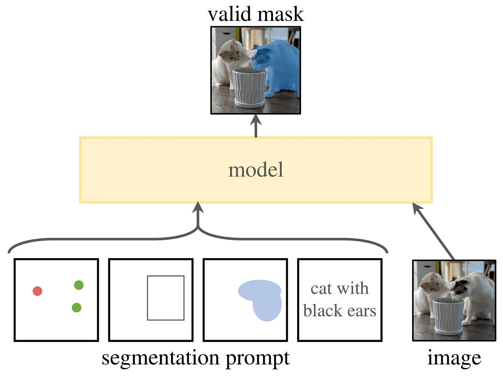
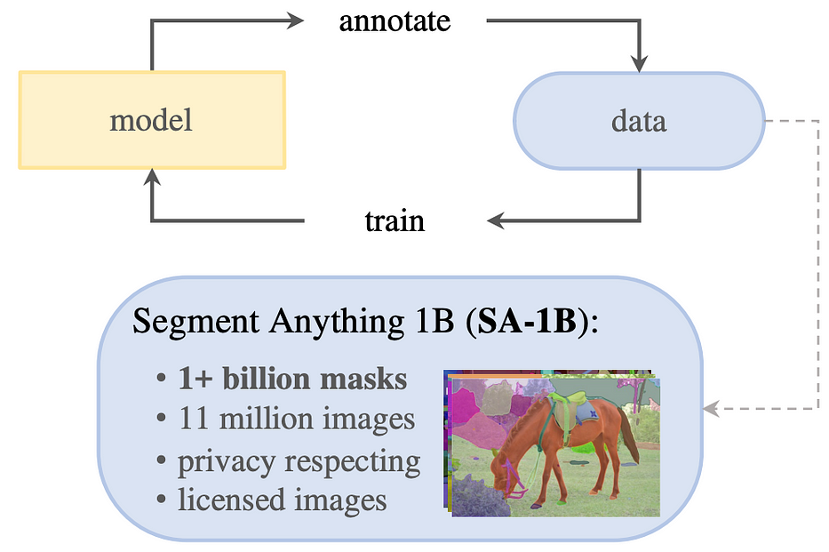

# Segmentation {#sec-segmentation}

Segmentation reasons about an image *below* the level of a box: it assigns labels to pixels. This chapter follows the field in three steps. First, the classical formulations—**semantic** segmentation with encoder–decoder CNNs (U-Net, DeepLab) and **instance** segmentation by adding a mask branch to a detector (Mask R-CNN, @sec-maskrcnn). Second, **mask classification** with transformers (MaskFormer and Mask2Former, @sec-mask2former), which unifies semantic, instance, and panoptic segmentation in one architecture. Third, **promptable foundation models**: the Segment Anything family (SAM, @sec-sam; SAM 2, @sec-sam2; SAM 3, @sec-sam3), which pre-trains once on a huge mask dataset and then segments new things at inference time by prompting. The chapter builds on the detectors of @sec-detection (Faster R-CNN, FPN, and DETR, @sec-detr) and on the ViT encoders of @sec-vit.

## Segmentation Tasks and Classical Models

Segmentation asks a model to reason about an image *below* the level of a single label or box. Three variants are worth distinguishing:

- **Semantic Segmentation** classifies **every pixel** into a fixed set of categories. It does *not* separate two objects of the same class—all "cat" pixels get the same label however many cats are present.
- **Instance Segmentation** additionally **distinguishes distinct objects** of the same class, producing one mask per instance.
- **Panoptic Segmentation** unifies the two by labelling both countable **"things"** (people, cars—with instance identities) and uncountable **"stuff"** (sky, grass, road) at the pixel level.

{#fig-seg-tasks width=95%}

### Semantic Segmentation {#sec-semantic-segmentation}

**Task**: Assign class label to every pixel: $f: \mathbb{R}^{H \times W \times 3} \rightarrow \{1, \ldots, C\}^{H \times W}$

**Challenges**:
- **Resolution**: Need pixel-level predictions (vs. classification's single label)
- **Context**: Local and global information both matter
- **Efficiency**: Dense predictions over full image

---

#### U-Net (2015)

**Architecture Philosophy**: Encoder-decoder with skip connections.

{#fig-unet width=60%}

**Encoder** (Contracting Path):
```
Input (572×572)
→ Conv-ReLU-Conv-ReLU → Skip1 (570×570, 64 ch)
→ MaxPool
→ Conv-ReLU-Conv-ReLU → Skip2 (280×280, 128 ch)
→ MaxPool
...
→ Bottleneck (28×28, 1024 ch)
```

**Decoder** (Expansive Path):
```
Bottleneck
→ UpConv → Concat(Skip4) → Conv-ReLU-Conv-ReLU
→ UpConv → Concat(Skip3) → Conv-ReLU-Conv-ReLU
...
→ Conv 1×1 → Output (388×388, C classes)
```

**Key Innovation - Skip Connections**:
- Encoder captures *what* (semantic information)
- Decoder recovers *where* (spatial details)
- Skip connections provide high-res features to decoder

**Why This Works**:
- Early layers: fine details (edges, textures)
- Deep layers: semantic meaning (object identity)
- Combining both: precise boundaries + correct labels

**Loss**: Pixel-wise softmax cross-entropy (see *Optimization* below).

**U-Net Variants**:
- **3D U-Net**: For volumetric data (medical CT/MRI)
- **U-Net++**: Nested skip connections
- **Attention U-Net**: Attention gates in skip connections

**Applications**: Medical imaging (won ISBI challenge), satellite imagery, microscopy

---

#### DeepLab v3+ (2018)

**Background**: DeepLab (v1, 2015) tackled the downsampling problem with **dilated (atrous) convolutions**, which enlarge the receptive field without reducing resolution or adding parameters, plus a fully-connected **Conditional Random Field (CRF)** to sharpen boundaries. v3+ replaces the CRF with an encoder-decoder.

**Core Ideas** (v3+):
1. **Atrous Spatial Pyramid Pooling (ASPP)**: Multi-scale context
2. **Encoder-Decoder**: U-Net-like structure
3. **Depthwise Separable Convs**: Efficiency

**ASPP Module**:
```
Feature Map
  ├─ 1×1 conv
  ├─ 3×3 atrous conv, rate=6
  ├─ 3×3 atrous conv, rate=12
  ├─ 3×3 atrous conv, rate=18
  └─ Global Average Pool → 1×1 conv → Upsample
      ↓
  Concatenate → 1×1 conv → Output
```

**Why Multiple Dilation Rates?**
- rate=6: captures medium context (~13×13 effective)
- rate=12: large context (~25×25 effective)
- rate=18: very large context (~37×37 effective)
- Global pooling: image-level features

**Motivation**: Objects vary in scale—need multi-scale receptive fields.

**Loss Function**: pixel-wise cross-entropy, optionally with focal loss for class imbalance (see *Optimization* below).

**DeepLab Performance**:
- PASCAL VOC 2012: 89.0% mIoU
- Cityscapes: 82.1% mIoU
- Real-time variants exist (MobileNet backbone)

---

### Optimization: Pixel-wise Loss and Class Imbalance

The standard objective for semantic segmentation is a **pixel-wise softmax cross-entropy**, averaged over pixels:

$$\mathcal{L} = -\frac{1}{H \cdot W} \sum_{i,j} \sum_{c=1}^C y_{ij}^{(c)} \log \hat{y}_{ij}^{(c)}$$

Dense prediction, however, is dominated by *easy* background pixels, and foreground/background imbalance can swamp the gradient. **Focal Loss** (Lin et al., 2017) [@lin2017focal] down-weights well-classified examples with a modulating factor $(1-p_t)^{\gamma}$:

$$
\mathrm{FL}(p_t) = -\,(1-p_t)^{\gamma}\,\log(p_t),
$$

where $p_t$ is the estimated probability of the ground-truth class and $\gamma \ge 0$ is a focusing parameter ($\gamma=2$ is typical; $\gamma = 0$ recovers cross-entropy). As $\gamma$ grows, confidently classified pixels contribute almost nothing, concentrating learning on the **hard, mis-classified** ones. (Focal loss was introduced for RetinaNet, a single-stage detector, and applies equally to segmentation.)

{#fig-focal width=70%}

---

### Instance Segmentation: Mask R-CNN (2017) {#sec-maskrcnn}

**Extension**: Mask R-CNN [@he2017maskrcnn] is **Faster R-CNN** (@sec-faster-rcnn) with two changes, shown in @fig-maskrcnn:

1. **RoI Align** replaces RoI pooling (see the RoI Align discussion below and @fig-roi-align), so the pooled features stay aligned with the pixels.
2. A small **fully convolutional network (FCN)** [@long2015fcn], a network built only from convolutions (and upsampling) that outputs a per-pixel prediction map (encoder–decoder segmentation models are covered in @sec-semantic-segmentation), is applied to each RoI as a third, parallel head that predicts its mask.

![Mask R-CNN = Faster R-CNN + an FCN on RoIs. The Faster R-CNN part (shaded) proposes regions, extracts fixed-size RoI features with RoIAlign, and predicts a class and box per RoI; a parallel mask branch of convolutions predicts a segmentation mask for each RoI. *Source: adapted from He et al., "Mask R-CNN" (ICCV 2017), Figure 1; annotated version from Wang (2020)* [@he2017maskrcnn; @wang2020maskrcnn].](/images/segmentation/mask_rcnn_architecture.jpg){#fig-maskrcnn width=80% fig-align="center"}

The three heads run in parallel on each RoI:

- **Box classification** ($C+1$ classes) and **box regression** (4 coordinates), exactly as in Faster R-CNN.
- **Mask prediction**: $C$ binary masks of size $28 \times 28$, one per class.

The ResNet-FPN backbone/neck is described in @sec-fpn.

**Mask Head**:
- Input: 14×14 ROI features from ROI Align
- Architecture: 4× Conv(256, 3×3) → Deconv(256, 2×2) → Conv(C, 1×1)
- Output: $C$ binary masks of size 28×28 (one per class)

**Loss Function**:
$$\mathcal{L} = \mathcal{L}_{\text{cls}} + \mathcal{L}_{\text{box}} + \mathcal{L}_{\text{mask}}$$

where:
$$\mathcal{L}_{\text{mask}} = -\frac{1}{m^2} \sum_{i,j} [y_{ij} \log \hat{y}_{ij} + (1-y_{ij}) \log(1-\hat{y}_{ij})]$$

**Key Detail**: Loss computed only on ground-truth class mask (not all $C$ masks).

**ROI Align** (see *ROI Pooling* above) replaces rounding with bilinear interpolation, keeping masks pixel-aligned.

![RoI Align on an $8\times 8$ feature map. The region proposal keeps its exact fractional coordinates (the box and its $2\times 2$ grid do not snap to cell boundaries), and each grid cell is then sampled with bilinear interpolation instead of being rounded to whole feature-map cells. Image Source: Ochman (2025) [@ochman2025roi].](/images/segmentation/roi_align.jpg){#fig-roi-align width=50% fig-align="center"}

**Example**:
- Proposal maps to feature map region [5.7, 8.3, 12.1, 15.9]
- ROI Pooling rounds to [6, 8, 12, 16] → 0.3-0.9 pixel errors
- ROI Align samples at exact 5.7, 8.3, etc. using interpolation

**Impact**: Critical for mask accuracy (2-3% mIoU improvement).

**Mask R-CNN Applications**:
- Instance segmentation (COCO, LVIS datasets)
- Keypoint detection (pose estimation)
- Panoptic segmentation (with Stuff head)

**Interview Question**: "Mask R-CNN vs. U-Net?" 
**Answer**: 
- U-Net: Semantic (no instances), faster, simpler
- Mask R-CNN: Instance-aware, slower (two-stage), handles occlusion better
- Use U-Net for medical imaging, Mask R-CNN for autonomous driving

---

## Universal Segmentation with Mask Transformers {#sec-mask2former}

Semantic, instance, and panoptic segmentation were long treated as separate problems with separate architectures: per-pixel classifiers (FCN, DeepLab) for semantic, detector-plus-mask-head (Mask R-CNN) for instance, and hybrids for panoptic. DETR (@sec-detr) suggests a unifying view: predict a **set of segments** with object queries and Hungarian matching. MaskFormer and Mask2Former turn this into a single architecture that is competitive on all three tasks.

### MaskFormer: Mask Classification (2021)

**Key idea**: replace *per-pixel classification* ("which class is this pixel?") with **mask classification** ("what is this segment, and which pixels belong to it?") [@cheng2021maskformer]. The same formulation covers all three tasks; only the label set and the post-processing change.

**Architecture**:
```
Image → Backbone → per-pixel features
      → Pixel decoder → per-pixel embeddings  E_pixel  (C_E × H × W)
      → Transformer decoder (N learned queries) → per-segment embeddings Q  (N × C_E)
            ├─ Class head: Q → softmax over (K classes + "no object")
            └─ Mask head:  MLP(Q) · E_pixel → N binary mask logits (N × H × W)
```

- Each of $N$ queries predicts one **class distribution** and one **binary mask**. The mask logit at pixel $(h,w)$ is the dot product of the query's mask embedding with the pixel embedding $E_{\text{pixel}}[:,h,w]$.
- **Training**: bipartite (Hungarian) matching between the $N$ predictions and the ground-truth segments, as in DETR, then a classification loss plus a mask loss (binary cross-entropy + Dice) on matched pairs.
- **Inference**: semantic segmentation takes, per pixel, the class-weighted sum of the mask probabilities; instance and panoptic segmentation keep the high-confidence (class, mask) pairs and resolve overlaps.

**Why it helps**: with $K$ classes, per-pixel classification has no notion of "segment", so it cannot separate instances; mask classification does, and it also scales better to large label sets (ADE20K has 150 classes, COCO-stuff has 171).

### Mask2Former: Masked Attention (2022)

MaskFormer matched specialized architectures on semantic segmentation but was slow to train and weaker on instance segmentation. **Mask2Former** [@cheng2022mask2former] keeps the mask-classification formulation and fixes the transformer decoder, which is where DETR-style models are slow to converge.

**Architecture** (@fig-mask2former): a backbone (ResNet or Swin) feeds a **pixel decoder** (multi-scale deformable attention, as in Deformable DETR), which produces multi-scale features at $1/32$, $1/16$ and $1/8$ of the input resolution plus high-resolution per-pixel embeddings at $1/4$. A **masked-attention transformer decoder** takes $N$ learnable queries and refines them over $L$ layers, one image scale per layer. Each query then predicts a class and, via a dot product with the per-pixel embeddings, a mask.

![Mask2Former. Left: the meta-architecture, a backbone, a pixel decoder producing multi-scale features, and a transformer decoder whose queries predict a class and a mask per segment. Right: one transformer decoder layer, where *masked attention* replaces standard cross-attention and is followed by self-attention among queries and an FFN. *Source: Cheng et al., "Masked-attention Mask Transformer for Universal Image Segmentation," CVPR 2022, Figure 2* [@cheng2022mask2former].](/images/segmentation/mask2former_architecture.jpg){#fig-mask2former width=80% fig-align="center"}

**Three changes that matter**:

1. **Masked attention.** In standard cross-attention every query attends to the whole image, which is why DETR converges slowly: attention starts out diffuse and must learn to localize. In masked attention, each query attends only to the **foreground region of the mask predicted by the previous decoder layer**:
$$\mathbf{X}_l = \operatorname{softmax}\!\big(\mathcal{M}_{l-1} + \mathbf{Q}_l \mathbf{K}_l^{\top}\big)\mathbf{V}_l + \mathbf{X}_{l-1}, \qquad \mathcal{M}_{l-1}(x,y) = \begin{cases} 0 & \text{if } M_{l-1}(x,y) = 1 \\ -\infty & \text{otherwise} \end{cases}$$
where $M_{l-1}$ is the binarized (threshold 0.5) mask prediction of layer $l-1$. Each layer therefore refines a segment that is already localized, and the context outside the segment is not needed for the local update (global context is still provided by self-attention among queries and by the pixel decoder).

2. **Multi-scale features, round-robin.** Small segments need high resolution; large ones need low resolution. Rather than feeding all scales to every layer (expensive), the decoder cycles through the $1/32$, $1/16$, $1/8$ feature maps, one scale per layer, and repeats this triplet three times (9 layers in total).

3. **Training efficiency.** Learnable query features (supervised directly, acting as a region-proposal-like prior), the order of self- and cross-attention swapped (cross-attention first, since the queries start without image information), and dropout removed. The mask loss is computed on **importance-sampled points** (about 12k per mask) rather than the full-resolution masks, cutting training memory roughly 3×.

**Loss**: $\mathcal{L} = \lambda_{\text{cls}}\mathcal{L}_{\text{cls}} + \lambda_{\text{ce}}\mathcal{L}_{\text{ce}} + \lambda_{\text{dice}}\mathcal{L}_{\text{dice}}$ on Hungarian-matched pairs, applied at every decoder layer (deep supervision).

**Results** (Swin-L backbone): 57.8 PQ on COCO panoptic, 50.1 AP on COCO instance, and 57.7 mIoU on ADE20K semantic segmentation—state of the art on all three at publication, with a single architecture trained separately per task.

**Where it sits**: Mask2Former is a closed-vocabulary, task-specific model: one set of weights per dataset and label set. It marks the end of the "train one segmentation model per task" era and is the direct architectural ancestor of the open-vocabulary and promptable models that follow.


---

## Promptable Foundation Models: The Segment Anything Family

Classical segmentation models are trained for a fixed label set on a fixed dataset. The **Segment Anything** (SAM) family from Meta AI instead treats segmentation as a *promptable foundation-model* problem: pre-train once on a very large mask dataset, then solve new segmentation tasks at inference time by prompting—points, boxes, masks, or text—with no task-specific fine-tuning. This section follows the line from the original **SAM** (@sec-sam) to its video extension **SAM 2** (@sec-sam2) and the open-vocabulary **SAM 3** (@sec-sam3). They build on the DETR-style detectors of @sec-detr and on the ViT encoders of @sec-vit.

### SAM: Segment Anything Model (2023) {#sec-sam}

**Segment Anything (SAM, 2023)** [@kirillov2023sam] mimics the recipe that produced foundation models in NLP: first **pre-train** a single model on a massive, generic dataset, then solve more specific downstream vision tasks through a vision analogue of **prompt engineering**.

#### Pre-training task: promptable segmentation

Given an input image *and* a **segmentation prompt**, output a **valid segmentation mask** for the object the prompt refers to. The prompt carries either

- **spatial information**—foreground/background points, a box, or a coarse mask; or
- **textual information**—a free-form phrase identifying the object.

The output should be a *valid* mask even when the prompt is ambiguous.

{#fig-sam-task width=55%}

#### Model architecture

To reconcile a **fine-grained image representation** with **fast, interactive** re-prompting, SAM splits computation into a heavy image encoder that runs **once per image** and lightweight modules that run **once per prompt**:

- **Image encoder**—a **Vision Transformer (ViT-H, 632M parameters)** [@dosovitskiy2021vit] pre-trained with **Masked Autoencoding (MAE)** [@he2022mae]. Input $1024\times1024$ → $64\times64\times256$ embedding, computed a single time per image.
- **Prompt encoder**—positional encodings for **points** and **boxes**; a small **convolutional network** for coarse input **masks**; a **CLIP** [@radford2021clip] **text encoder** for **free-form text**.
- **Mask decoder**—a lightweight **two-layer transformer decoder**: self-attention over prompt and mask tokens, cross-attention to the image embedding. It outputs 3 masks plus 3 IoU confidence scores.

**Ambiguity** in the referred object (does a point on a shirt mean the shirt, the person, or a stripe?) is handled by predicting masks at **three levels of granularity**—**whole object, part, and subpart**. During training the loss is applied only to the predicted mask with the **highest IoU** with the ground truth, so the model learns a small set of plausible masks instead of averaging them. Each mask comes with a **predicted IoU (confidence) score**.

{#fig-sam-arch width=95%}

#### Dataset: SA-1B and the data engine

SAM is trained on **SA-1B**—**11M images** with **1.1B masks** (≈100 masks per image), by far the largest segmentation dataset of its time. Such scale needs a **model-in-the-loop data engine** with **three stages**:

1. **Model-assisted manual annotation.** Annotators label any object they can name, aided by SAM's coarse mask suggestions, which they refine with **brush/erase** tools. Yields **120K images / 4.3M masks**.
2. **Semi-automatic.** To increase **object diversity**, a model trained on stage 1 pre-fills confident masks; annotators focus on the remaining less salient objects. Yields **180K images / 5.9M masks**.
3. **Fully automatic.** A SAM model trained on stages 1–2 is prompted with a **regular $32{\times}32$ point grid**. Masks are filtered by predicted IoU (**confidence**) and by a **stability** check (thresholding the probability map at $0.5 \pm \delta$ should give near-identical masks); **non-maximum suppression** removes duplicates. This stage produces the bulk of the billion masks.

{#fig-sa1b width=45%}

#### Zero-shot transfer

The pre-trained SAM transfers, **without fine-tuning**, to tasks that differ significantly from the promptable-segmentation objective (evaluated on 23 datasets):

| Task | Prompt | Result |
|------|--------|--------|
| Single-point segmentation | 1 foreground point (most confident of 3 masks) | Better than RITM, the interactive-segmentation SOTA |
| Edge detection | $16{\times}16$ grid of points (768 masks); mask boundaries as edges | Competitive with supervised ViT |
| Object proposals | Automatic mask generation | Outperforms EdgeBoxes |
| Instance segmentation | Boxes from an object detector | 94% of fully-supervised ViTDet |
| Text-to-mask | Train with CLIP *image* embedding of each mask as the prompt; at inference swap in CLIP's *text* embedding | Segmentation from a text query |

**Applications**: photo editing, medical imaging (MedSAM), robotics, video tracking.

### SAM 2: Segment Anything in Images and Videos {#sec-sam2}

**SAM 2 (2024)** [@ravi2024sam2] generalizes SAM from static images to
**video**, unifying image and video segmentation under a single
**Promptable Visual Segmentation (PVS)** task. In PVS, a prompt (points,
box, or mask) may be supplied on **any frame**, and the model must produce
a **spatio-temporal mask** — a *masklet* — that segments and **tracks** the
target object through the entire clip, while remaining interactively
correctable: an extra click on a later frame refines the whole masklet.

{#fig-sam2-overview width=95%}

{#fig-sam2-demo width=85%}

The core challenge relative to images is **temporal consistency under
occlusion, appearance change, and re-identification**. SAM 2 addresses
this with a **streaming memory** architecture that processes frames one at
a time and conditions each prediction on what it has already seen:

- **Image encoder (streaming).** A **hierarchical (Hiera)** vision
  transformer encodes each incoming frame *once*, in a streaming fashion,
  producing per-frame embeddings — the video analogue of SAM's single-pass
  image encoder, enabling **real-time** interaction.
- **Memory bank.** A FIFO queue stores features and predicted masks from a
  window of **recent frames** plus the **prompted frames**, together with
  **object pointers** — compact tokens summarizing the object's appearance.
- **Memory attention.** Before decoding the current frame, transformer
  blocks let the frame embedding **cross-attend to the memory bank**, so
  the mask prediction is conditioned on the object's past appearance and
  motion.
- **Prompt encoder & mask decoder.** Essentially inherited from SAM, but
  now conditioned on the memory-attended features. As in SAM, **ambiguity
  is resolved by emitting multiple candidate masks** and keeping the
  highest-confidence one; an added **occlusion head** predicts whether the
  object is **present at all** in the current frame, which is essential for
  objects that leave and re-enter the view.

{#fig-sam2-arch width=95%}

Because a single image is just a one-frame video, this architecture
subsumes SAM: on still images SAM 2 is **more accurate and roughly
6× faster** than the original SAM, while also handling video.

#### The SA-V dataset

SAM 2 is trained with the same model-in-the-loop philosophy, using an
interactive engine in which annotators correct SAM 2's own masklets frame
by frame. The resulting **SA-V** dataset is the largest video segmentation
resource to date — **50.9K videos** (**196 hours**) with **642.6K masklets**
and **35.5M masks** — deliberately covering whole objects **and their
parts** to match SAM's granularity.

### SAM 3: Segment Anything with Concepts {#sec-sam3}

**SAM 3 (November 2025)** [@carion2025sam3] takes the decisive step from
**geometric** prompting (a point/box/mask always refers to *one* object)
to **conceptual** prompting. It introduces **Promptable Concept
Segmentation (PCS)**: given a **concept prompt** — a **short noun phrase**
(e.g. *"yellow school bus"*, *"striped cat"*), one or more **image
exemplars**, or a combination — the model must **detect, segment, and
track *every* instance** of that concept across an image or video, each
with a unique identity. This aligns SAM with the **open-vocabulary**
goal of modern instance segmentation: exhaustively finding *all*
occurrences of an open-ended category, rather than a single prompted
object. SAM 3 also retains SAM 2's interactive **PVS** capabilities.

{#fig-sam3-task width=95%}

**Architecture — a decoupled detector + tracker sharing one backbone.**
SAM 3 is an **848M-parameter** model built from:

- A **shared vision backbone** feeding both sub-systems.
- An **image-level detector** — a **DETR-based** (@sec-detr) model
  conditioned on the concept prompt (text, image exemplars, or geometry),
  which localizes and segments all instances in a frame.
- A **memory-based video tracker** that **inherits the SAM 2** streaming
  memory design (@sec-sam2) to propagate instance identities across
  frames.

A central innovation is the **presence head**, which **decouples
recognition from localization**. Rather than asking each detection query
to simultaneously decide *"is this concept present?"* and *"where is
it?"*, a dedicated **presence token** answers the *what/whether* question
globally, freeing the query embeddings to focus on *where*. This
disentanglement markedly improves discrimination between **similar
concepts** and boosts detection accuracy — particularly with the **hard
negatives** (visually confusable non-matches) baked into training.

![SAM 3 architecture. A **text encoder** and **image encoder** embed the concept prompt ("a penguin"), optional image **exemplar**, and current frame. A **Detector** (new in SAM 3) segments all matching instances in frame $t$, while a **Tracker** (inherited from SAM 2, with its **Memory Bank**) propagates masks from frame $t{-}1$; the two mask sets are merged into the output for frame $t$. Colours mark components from the prompt encoder (PE), from SAM 2, and new in SAM 3. *Source: SAM 3, "Segment Anything with Concepts" (2025).*](/images/segmentation/sam3_model.png){#fig-sam3-model width=95%}

**Data — the SA-Co data engine.** SAM 3 is trained on **Segment Anything
with Concepts (SA-Co)**, produced by a scalable data engine that mixes AI
annotators with humans and yields on the order of **4M unique concept
labels** (including deliberate hard negatives) across images and videos —
far beyond the closed vocabularies of COCO or LVIS.

{#fig-sam3-data width=95%}

**Results.** SAM 3 roughly **doubles (≈2×) the accuracy** of prior systems
on both image and video PCS, while **maintaining and improving** SAM 2's
interactive visual-segmentation quality. On the accompanying **SA-Co
benchmark** — which spans **270K unique concepts**, over 50× more than
existing benchmarks — it reaches an estimated **75–80% of human
performance**. Meta open-sourced both the model and the SA-Co benchmark.

**The trajectory in one line.** SAM made segmentation **promptable** and
class-agnostic; SAM 2 made it **temporal**, tracking a prompted object
through video with streaming memory; SAM 3 makes it **conceptual and
exhaustive**, turning a phrase or exemplar into masks for *all* matching
instances across images and video.

---

## Summary and Interview Preparation

### Core Concepts Checklist

- [ ] Semantic vs. instance vs. panoptic; things vs. stuff
- [ ] U-Net skip connections; DeepLab dilated convolutions and ASPP
- [ ] Pixel-wise cross-entropy, Dice, and focal loss; handling class imbalance
- [ ] Mask R-CNN: per-class mask loss and RoI Align
- [ ] Mask classification (MaskFormer/Mask2Former): queries, Hungarian matching, masked attention
- [ ] SAM: promptable task, heavy image encoder + light decoder, ambiguity-aware multi-mask output, data engine
- [ ] SAM 2 streaming memory; SAM 3 concept prompts and presence head

### Common Interview Questions

**Q: Mask R-CNN vs. U-Net?**

U-Net: semantic only, faster, simpler (medical imaging). Mask R-CNN: instance-aware, two-stage, handles occlusion (autonomous driving).

---

**Q: What is mask classification, and why is it better than per-pixel classification?**

Instead of classifying every pixel, the model predicts $N$ (class, binary mask) pairs, as in DETR but with masks. Segments, rather than pixels, are the unit of prediction, so the same model handles semantic, instance, and panoptic segmentation, and instances of the same class are naturally separated.

---

**Q: What is masked attention in Mask2Former, and what problem does it solve?**

Each query's cross-attention is restricted to the foreground of the previous layer's predicted mask (everything else gets $-\infty$ before the softmax). Standard cross-attention in DETR starts diffuse and must learn to localize, which makes convergence slow; masked attention starts from a localized region and refines it, so training is much faster (50 epochs on COCO) and instance segmentation improves.

---

**Q: How does Mask2Former differ from Mask R-CNN?**

Mask R-CNN is a detector with a mask branch: it relies on anchors, RoIs, and NMS, and predicts one low-resolution (28×28) mask per RoI. Mask2Former has no anchors, RoIs, or NMS: queries predict full-resolution masks directly via a dot product with per-pixel embeddings, trained with Hungarian matching, and it covers semantic and panoptic segmentation as well.

---

**Q: How does SAM handle ambiguous prompts?**

A single click on a shirt could mean the shirt, the person, or a stripe. SAM predicts three masks at different granularities (whole, part, subpart) with an IoU confidence score for each. During training the loss is computed only on the mask with the highest IoU with the ground truth, so the three outputs specialize instead of averaging into one blurry mask, and the scores let a user (or a downstream system) rank them.

---

**Q: Why does SAM use a heavy image encoder but a tiny mask decoder?**

The image embedding is computed once per image (expensive ViT-H forward pass), while each new prompt only runs the prompt encoder and a two-layer decoder against the cached embedding. This amortization is what makes interactive, real-time re-prompting possible.

---

**Q: What is the SAM data engine, and why was it necessary?**

Dense masks are too expensive to annotate by hand at the billion scale. The engine bootstraps: SAM assists annotators (stage 1), then pre-labels confident masks so humans only add the rest (stage 2), then runs fully automatically from a point-grid prompt with confidence and stability filtering (stage 3). Each stage's data retrains the model, so the model and dataset improve together.

---

**Q: How does SAM 3 differ from SAM and SAM 2?**

SAM prompts are *geometric* and refer to one object; SAM 2 adds time (a memory bank tracks a prompted object through video); SAM 3 adds *concept* prompts (noun phrases or exemplars) that must find and track **every** instance, using a DETR-style detector with a presence head plus the SAM 2 tracker.
