# Generative Adversarial Networks (GANs) {#sec-gans}

## Introduction

**Generative Adversarial Networks** (GANs) [@goodfellow2014gan] learn to generate data through a game between two neural networks. Unlike VAEs, which model the data density explicitly, GANs learn an *implicit* generative model: they can sample from the data distribution but never compute its likelihood.

**Intuition**: a counterfeiter (the generator) tries to print fake banknotes, and a police officer (the discriminator) tries to tell fakes from real notes. Each improves by competing with the other, until the fakes are indistinguishable from the real thing.

- **Generator** $G$: maps random noise to a fake sample, trying to fool $D$
- **Discriminator** $D$: outputs the probability that a sample is real, trying to catch $G$

**Key insight**: the generator never sees real data. It only receives gradients through the discriminator's judgment, and this indirect supervision yields remarkably sharp samples.

---

## The Minimax Game

$G$ and $D$ play a minimax game over a value function $V(D, G)$:

$$\min_G \max_D V(D, G) = \mathbb{E}_{x \sim p_{\text{data}}}[\log D(x)] + \mathbb{E}_{z \sim p_z}[\log(1 - D(G(z)))]$$

- **Discriminator** maximizes $V$: push $D(x) \to 1$ on real data and $D(G(z)) \to 0$ on fakes. This is exactly the binary cross-entropy of a real-vs-fake classifier.
- **Generator** minimizes $V$: push $D(G(z)) \to 1$, i.e. make fakes look real.

At the theoretical optimum the generator matches the data distribution, $p_g = p_{\text{data}}$, and the discriminator can only output $D(x) = \tfrac{1}{2}$ everywhere.

### Architecture

- **Generator** $G: \mathcal{Z} \to \mathcal{X}$, with $z \sim \mathcal{N}(0, I)$: projection of $z$, then stacked transposed convolutions, then Tanh.
- **Discriminator** $D: \mathcal{X} \to [0,1]$: stacked strided convolutions, then a sigmoid output.

### Training

Training alternates between the two networks:

1. **Discriminator step** (repeated $k$ times, typically $k=1$): sample real $x$ and fake $G(z)$, then take a gradient step on
$$\mathcal{L}_D = -\big[\log D(x) + \log(1 - D(G(z)))\big]$$
2. **Generator step**: sample fresh $z$ and take a gradient step on the **non-saturating** loss
$$\mathcal{L}_G = -\log D(G(z))$$

The generator minimizes $-\log D(G(z))$ instead of $\log(1 - D(G(z)))$ because the latter has vanishing gradients early in training, when $D$ easily rejects fakes (see [Vanishing Gradients](#sec-gan-vanishing)).

::: {.callout-note collapse="true" title="Code: one GAN training step (PyTorch)"}

```python
bce = torch.nn.functional.binary_cross_entropy_with_logits  # D outputs logits

# --- discriminator step ---
x_fake = G(torch.randn(batch, z_dim))
loss_D = bce(D(x_real), torch.ones(batch, 1)) \
       + bce(D(x_fake.detach()), torch.zeros(batch, 1))  # detach: no gradient into G
opt_D.zero_grad(); loss_D.backward(); opt_D.step()

# --- generator step (non-saturating loss) ---
loss_G = bce(D(x_fake), torch.ones(batch, 1))  # label fakes as "real"
opt_G.zero_grad(); loss_G.backward(); opt_G.step()
```
:::

---

## Unconditional Image Generation

### DCGAN (2015)

**Key contribution**: architecture guidelines that made GAN training on images stable [@radford2016dcgan].

1. Replace pooling with **strided convolutions** (discriminator) and **transposed convolutions** (generator)
2. Use **batch normalization** in both networks (not on the generator output or discriminator input)
3. Remove fully connected hidden layers
4. **ReLU** in the generator (Tanh at the output), **LeakyReLU(0.2)** in the discriminator

![The DCGAN generator: a 100-d noise vector is projected and reshaped to a $4{\times}4{\times}1024$ tensor, then four transposed convolutions with stride 2 double the resolution each time until a $64{\times}64{\times}3$ image $G(z)$ is produced. Figure from Radford et al. [@radford2016dcgan].](/images/gans/dcgan_generator_architecture.png){#fig-dcgan width=90% fig-align="center"}

---

### WGAN (2017)

**Motivation**: the standard GAN loss is hard to optimize. A strong discriminator saturates and stops giving gradients, and when $p_g$ and $p_{\text{data}}$ have disjoint supports the Jensen–Shannon divergence is constant.

**Key idea**: replace the discriminator with a **critic** $f$ that outputs an unbounded score, and optimize the **Wasserstein (Earth Mover's) distance**, the cost of moving the mass of $p_g$ onto $p_{\text{data}}$ [@arjovsky2017wgan]:

$$W(p_{\text{data}}, p_g) = \sup_{\|f\|_L \leq 1} \; \mathbb{E}_{x \sim p_{\text{data}}}[f(x)] - \mathbb{E}_{z \sim p_z}[f(G(z))]$$

The supremum runs over **1-Lipschitz** critics (Kantorovich–Rubinstein duality), so the critic must be smooth. The resulting losses are:

$$\mathcal{L}_{\text{critic}} = \mathbb{E}_z[f(G(z))] - \mathbb{E}_x[f(x)], \qquad \mathcal{L}_G = -\mathbb{E}_z[f(G(z))]$$

| Aspect | Standard GAN | WGAN |
|--------|-------------|------|
| Discriminator output | Sigmoid (probability) | Linear (score) |
| Loss | Binary cross-entropy | Wasserstein distance |
| Constraint | None | 1-Lipschitz |
| Gradient when distributions are disjoint | Vanishes | Still informative |

**Enforcing Lipschitz**: the original WGAN **clips the critic's weights** to a small range:

```python
for p in critic.parameters():
    p.data.clamp_(-0.01, 0.01)
```

This is crude: it limits the critic's capacity, makes the loss surface unstable or flat, and slows convergence.

---

### WGAN-GP (2017)

**Improvement**: replace weight clipping with a **gradient penalty** that softly pushes the critic's gradient norm towards 1 [@gulrajani2017wgangp]. The penalty is evaluated at random interpolations between real and fake samples (@fig-wgan-gp):

$$\hat{x} = \epsilon\, x + (1-\epsilon)\, G(z), \qquad \epsilon \sim U[0,1]$$

$$\mathcal{L}_{\text{critic}} = \mathbb{E}_z[f(G(z))] - \mathbb{E}_x[f(x)] + \lambda\, \mathbb{E}_{\hat{x}}\Big[\big(\|\nabla_{\hat{x}} f(\hat{x})\|_2 - 1\big)^2\Big]$$

with $\lambda = 10$ as standard. The critic keeps its full capacity and optimization is smoother, so WGAN-GP became the default Wasserstein variant.

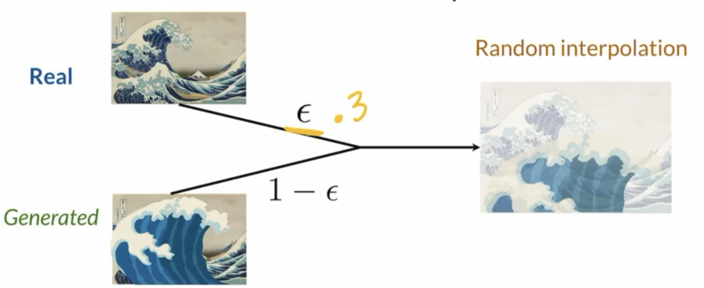{#fig-wgan-gp width=75% fig-align="center"}

---

## Conditional Image Generation

### Conditional GAN (2014)

**Idea**: feed a label $y$ to both networks, so the generator produces samples *of a given class* [@mirza2014cgan]:

$$\min_G \max_D \; \mathbb{E}_{x,y}[\log D(x \mid y)] + \mathbb{E}_{z,y}[\log(1 - D(G(z \mid y) \mid y))]$$

The label is typically embedded and concatenated to the generator's noise input and to the discriminator's input.

**Applications**: class-conditional generation (e.g. ImageNet), text-to-image synthesis, super-resolution, and image-to-image translation (below).

---

### Progressive GAN (2017)

Generating high-resolution images directly is unstable. **Progressive growing** [@karras2018progan] trains $G$ and $D$ at $4{\times}4$ first, then adds layers to double the resolution step by step, up to $1024{\times}1024$ (@fig-progan).

![Progressive growing. Training starts with $4{\times}4$ generator and discriminator, and layers are added as training progresses until the full resolution is reached. Adapted from Karras et al. [@karras2018progan]; yellow annotations added. TODO: confirm source.](/images/gans/progan_training_progression.png){#fig-progan width=90% fig-align="center"}

**Fade-in**: a new block is blended in smoothly. The output mixes the upsampled previous output with the new block's output, with weight $\alpha$ ramping from 0 to 1 (@fig-progan-fade):

$$x = \alpha \cdot x_{\text{new}} + (1-\alpha) \cdot \text{upsample}(x_{\text{prev}})$$

::: {#fig-progan-fade layout-ncol=2}

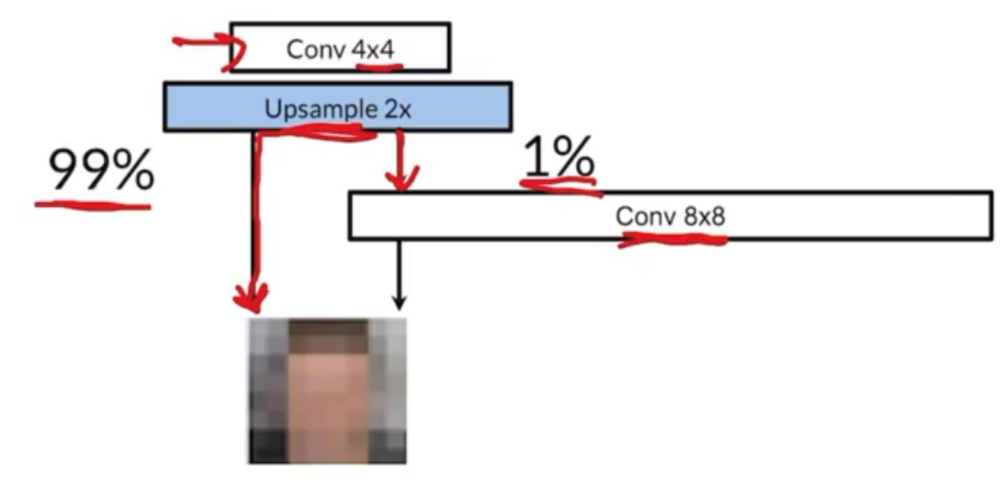{#fig-progan-fade-g}

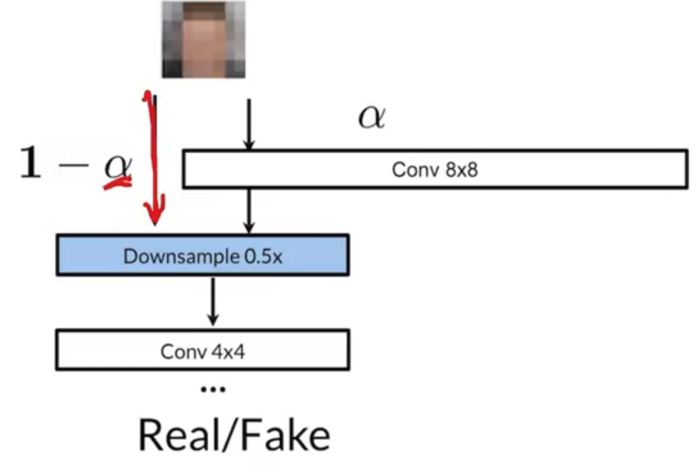{#fig-progan-fade-d}

Fade-in of a new resolution block in the generator and the discriminator.
:::

**Benefits**: stable training at high resolution, faster convergence, much sharper results than prior GANs.

---

### StyleGAN (2018)

**Goal**: control the generated image at different scales. StyleGAN [@karras2019stylegan] builds on Progressive GAN with a style-based generator (@fig-stylegan).

**1. Mapping network** $f: \mathcal{Z} \to \mathcal{W}$: an 8-layer MLP maps $z \sim \mathcal{N}(0,I)$ to an intermediate latent $w$ that is less entangled than $z$.

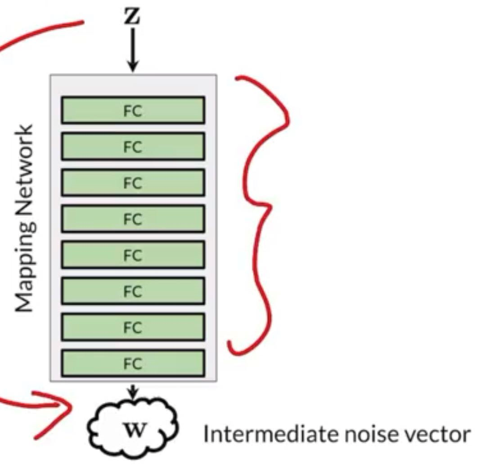{#fig-stylegan-mapping width=40% fig-align="center"}

**2. Synthesis network**: starts from a **learned constant** (not from the noise) and upsamples progressively. At every layer, $w$ is injected through **AdaIN**.

**3. AdaIN** (Adaptive Instance Normalization): normalize each channel of each image on its own (instance norm, @fig-norm-variants), then rescale with a per-channel scale and bias predicted from $w$ by two small fully connected layers (@fig-adain):

$$\text{AdaIN}(x_i, w) = y_{s,i}(w)\, \frac{x_i - \mu(x_i)}{\sigma(x_i)} + y_{b,i}(w)$$

So $w$ controls the *style* (per-channel statistics) while the convolutions carry the *content*.

::: {#fig-adain layout-ncol=2}

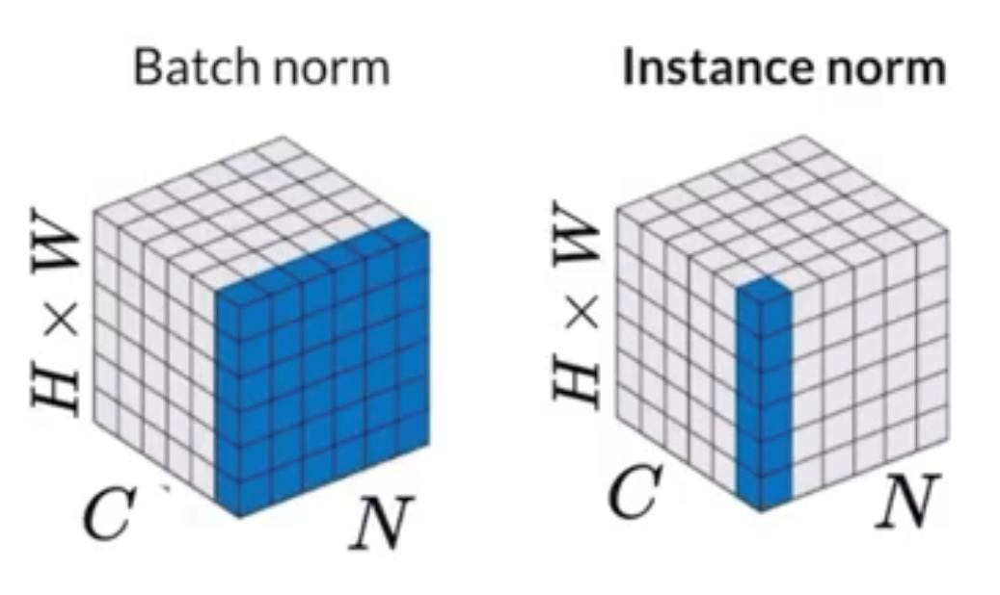{#fig-adain-norm}

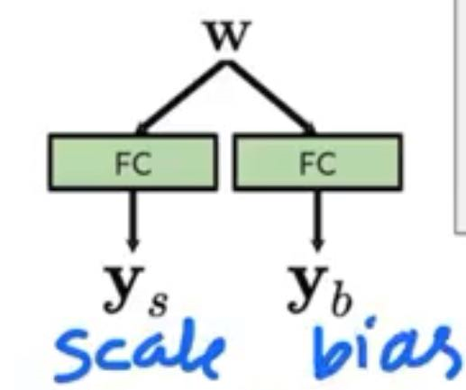{#fig-adain-fc width=70%}

Instance normalization and the AdaIN style parameters.
:::

**4. Noise injection**: per-pixel Gaussian noise, scaled by a learned per-channel weight, is added at every layer. It does not change the identity or style, only **stochastic details** (hair strands, pores, freckles).

![The StyleGAN generator. The mapping network produces $w$, which is fed into every resolution block of the synthesis network via AdaIN. Gaussian noise is sampled and added before each AdaIN. Based on Karras et al. [@karras2019stylegan].](/images/gans/stylegan_architecture_noise_injection.png){#fig-stylegan width=90% fig-align="center"}

**5. Hierarchical style control and style mixing**: different layers control different scales, so injecting different $w$ vectors at different depths mixes their attributes:

- **Coarse** ($4^2$–$8^2$): pose, face shape
- **Middle** ($16^2$–$32^2$): facial features, hairstyle
- **Fine** ($64^2$–$1024^2$): colors, micro-structure

During training, **style mixing regularization** feeds two different $w$ into different layers, which stops the network from assuming adjacent styles are correlated.

::: {#fig-style-mixing layout-ncol=2}

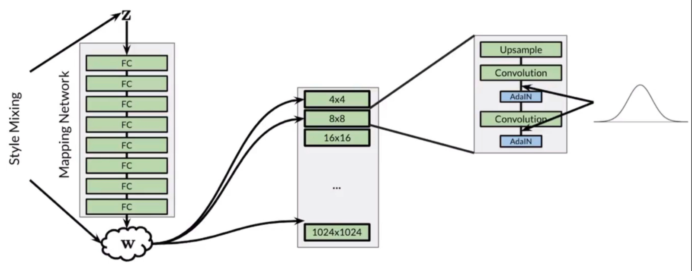{#fig-style-mixing-diagram}

![Results: copying coarse, middle or fine styles from source $w_2$ into images generated from $w_1$. From Karras et al. [@karras2019stylegan], annotated.](/images/gans/stylegan_style_mixing_results.png){#fig-style-mixing-results}

Style mixing. Coarse styles from $w_2$ change pose and face shape, middle styles change facial features, fine styles change colors and texture.
:::

**Results**: FID $\approx 4.4$ on FFHQ faces at $1024{\times}1024$. **StyleGAN2** [@karras2020stylegan2] removes progressive growing and replaces AdaIN with weight demodulation to eliminate characteristic artifacts, reaching FID $\approx 2.8$.

---

## Image-to-Image Translation

**Goal**: learn a mapping from a source domain $X$ to a target domain $Y$ (sketch → photo, segmentation → scene, horse → zebra).

- **Paired**: aligned examples $(x_i, y_i)$ are available
- **Unpaired**: two collections with no correspondence

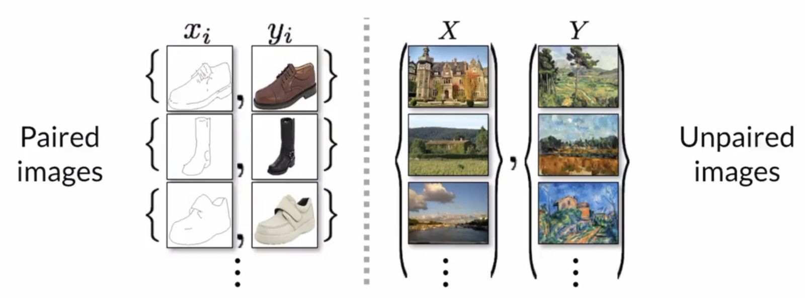{#fig-paired-unpaired width=85% fig-align="center"}

### Pix2Pix (2016): Paired Translation

Pix2Pix [@isola2017pix2pix] is a conditional GAN: it learns $G: X \to Y$ from pairs, for instance generating a realistic building from a segmentation mask (@fig-pix2pix-task).

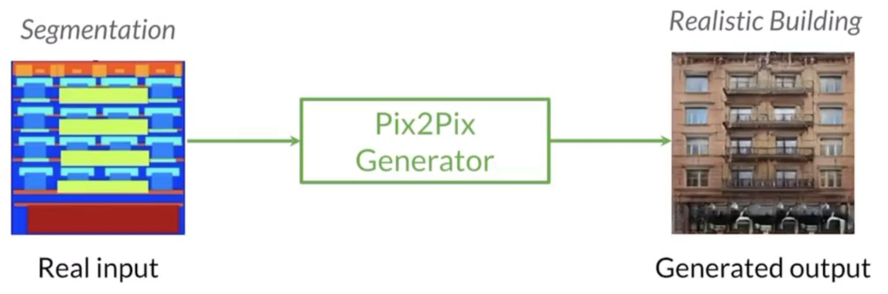{#fig-pix2pix-task width=75% fig-align="center"}

- **Generator**: a **U-Net**, whose skip connections preserve spatial detail. Dropout in the decoder provides the randomness (diversity).
- **Discriminator**: **PatchGAN**, a fully convolutional network that outputs a grid of real/fake scores, one for each local patch of the image, judging the input paired with the real or generated output (@fig-patchgan).

::: {#fig-patchgan layout-ncol=2}

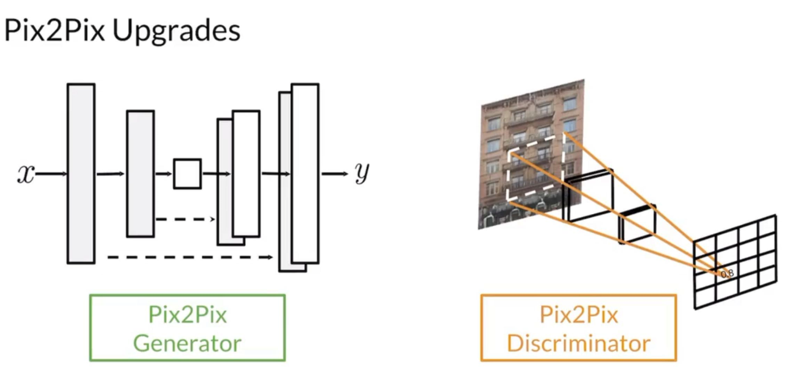{#fig-patchgan-arch}

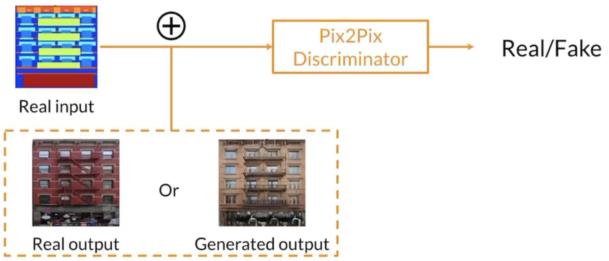{#fig-patchgan-input}

The Pix2Pix generator and discriminator.
:::

**Loss**: a per-patch adversarial loss (BCE or Wasserstein) plus a pixel-wise L1 term:

$$\mathcal{L}_{\text{Pix2Pix}} = \mathcal{L}_{\text{GAN}} + \lambda\, \mathcal{L}_{\text{L1}}, \qquad \mathcal{L}_{\text{L1}} = \mathbb{E}_{x,y}\big[\|y - G(x)\|_1\big]$$

The GAN term encourages realistic textures; the L1 term keeps the output close to the paired target.

---

### CycleGAN (2017): Unpaired Translation

CycleGAN [@zhu2017cyclegan] learns two mappings $G: X \to Y$ and $F: Y \to X$ with two discriminators $D_Y$, $D_X$ (PatchGAN) (@fig-cyclegan).

**Cycle consistency**: translating forward then back must recover the input:

$$F(G(x)) \approx x, \qquad G(F(y)) \approx y$$

; method from @zhu2017cyclegan. TODO: confirm figure source.](/images/gans/cyclegan_architecture.png){#fig-cyclegan width=85% fig-align="center"}

**Total loss**:

$$\mathcal{L} = \mathcal{L}_{\text{GAN}}(G, D_Y) + \mathcal{L}_{\text{GAN}}(F, D_X) + \lambda_1 \mathcal{L}_{\text{cyc}} + \lambda_2 \mathcal{L}_{\text{id}}$$

- **Adversarial (least squares)**, shown for $G$ and $D_Y$ (symmetric for $F$ and $D_X$):
$$\mathcal{L}_{D_Y} = \mathbb{E}_y[(D_Y(y) - 1)^2] + \mathbb{E}_x[D_Y(G(x))^2], \qquad \mathcal{L}_{G} = \mathbb{E}_x[(D_Y(G(x)) - 1)^2]$$
- **Cycle consistency**: the round trip recovers the original
$$\mathcal{L}_{\text{cyc}} = \mathbb{E}_x\big[\|F(G(x)) - x\|_1\big] + \mathbb{E}_y\big[\|G(F(y)) - y\|_1\big]$$
- **Identity**: a generator fed an image already from its target domain should leave it unchanged
$$\mathcal{L}_{\text{id}} = \mathbb{E}_y\big[\|G(y) - y\|_1\big] + \mathbb{E}_x\big[\|F(x) - x\|_1\big]$$

**Applications**: horse ↔ zebra, season transfer, photo ↔ painting style.

---

## Evaluation Metrics

GANs have no tractable likelihood, so we use proxy metrics that capture **quality** (fidelity) and **diversity** of the generated images.

### Inception Score (IS)

Good generated images should be **sharp** (each image clearly belongs to one class: $p(y|x)$ has low entropy) and **diverse** (many classes are covered: the marginal $p(y)$ has high entropy). Here $p(y|x)$ is the class distribution predicted by a pretrained Inception-v3 [@salimans2016improved]:

$$\text{IS} = \exp\Big(\mathbb{E}_{x \sim p_g}\big[\text{KL}(p(y|x) \,\|\, p(y))\big]\Big), \qquad p(y) = \mathbb{E}_x[p(y|x)]$$

Equivalently, the log-score is a difference of entropies:

$$\ln \text{IS} = \underbrace{H(y)}_{\text{diversity}} - \underbrace{\mathbb{E}_x[H(y|x)]}_{\text{uncertainty per image}}$$

::: {.callout-tip collapse="true" appearance="minimal" title="Derivation (click to expand)"}

$$\text{KL}(p(y|x) \| p(y)) = \sum_y p(y|x) \log p(y|x) - \sum_y p(y|x) \log p(y) = -H(y|x) - \sum_y p(y|x) \log p(y)$$

Taking the expectation over $x$, and using $\mathbb{E}_x[p(y|x)] = p(y)$:

$$\mathbb{E}_x[\text{KL}(p(y|x) \| p(y))] = -\mathbb{E}_x[H(y|x)] + H(y)$$

This is also the mutual information $I(y; x)$ between images and their predicted class.
:::

**Limitation**: IS evaluates $p_g$ in isolation and never compares it to the real data. A generator can score well with one perfect image per class, by memorizing the training set, or by producing sharp but unrealistic images.

---

### Fréchet Inception Distance (FID)

FID [@heusel2017fid] compares the real and generated distributions in the feature space of Inception-v3 (the layer before the classifier). It fits a Gaussian $(\mu, \Sigma)$ to each set of features and computes the Fréchet (Wasserstein-2) distance between them:

$$\text{FID} = \underbrace{\|\mu_r - \mu_g\|^2}_{\text{means}} + \underbrace{\text{Tr}\Big(\Sigma_r + \Sigma_g - 2(\Sigma_r \Sigma_g)^{1/2}\Big)}_{\text{covariances}}$$

- **Lower is better**; FID $=0$ when both distributions match.
- **Mean term**: the average generated image looks different from the average real one (wrong global appearance, color, style).
- **Covariance term**: generated samples have a different diversity or correlation structure, so it penalizes mode collapse.

**Versus IS**: FID needs real and generated samples and is the primary metric today. IS is only a quick check.

---

### Precision and Recall

FID is one number and cannot tell a *quality* failure from a *diversity* failure. Precision and Recall measure them separately [@kynkaanniemi2019improved].

Extract features for a sample of real images ($\Phi_r$) and generated images ($\Phi_g$). Approximate each **manifold** as the union of hyperspheres centered on each feature point, with radius equal to the distance to its $k$-th nearest neighbor (@fig-pr-manifolds):

$$\text{manifold}(\Phi) = \bigcup_{\phi \in \Phi} B\big(\phi, \, \text{NN}_k(\phi)\big)$$

$$\text{Precision} = \frac{1}{|\Phi_g|} \sum_{\phi_g \in \Phi_g} \mathbb{1}\big[\phi_g \in \text{manifold}(\Phi_r)\big], \qquad \text{Recall} = \frac{1}{|\Phi_r|} \sum_{\phi_r \in \Phi_r} \mathbb{1}\big[\phi_r \in \text{manifold}(\Phi_g)\big]$$

- **Precision** (fidelity): fraction of generated samples that fall in the real manifold
- **Recall** (diversity): fraction of real samples that fall in the generated manifold

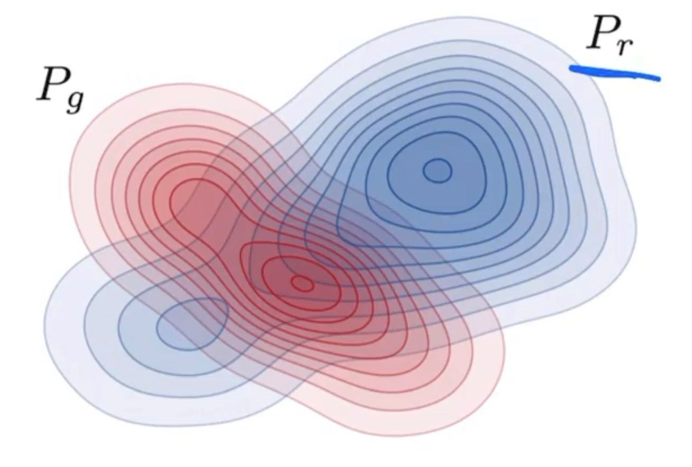{#fig-pr-manifolds width=60% fig-align="center"}

::: {#fig-pr-examples layout-ncol=2}

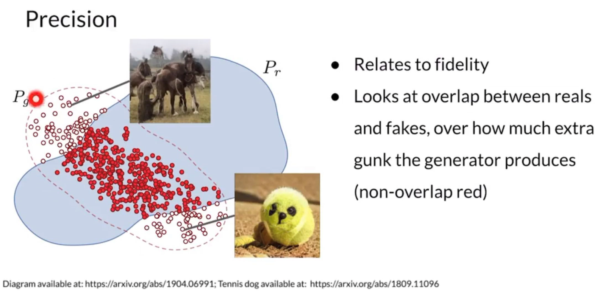{#fig-precision}

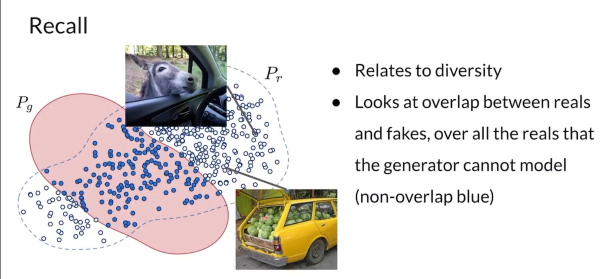{#fig-recall}

Precision relates to fidelity, recall to diversity.
:::

**Diagnosis**: high precision with low recall means **mode collapse**; low precision with high recall means diverse but low-quality samples.

---

## Training Challenges

### Mode Collapse

**Problem**: the generator covers only a few modes of the data distribution (e.g. only the digits 1 and 7 on MNIST) because those already fool the discriminator.

**Symptoms**: similar-looking samples, low Recall, oscillating discriminator loss.

**Fixes**: **WGAN-GP** (better gradients), **minibatch discrimination** (the discriminator sees batch-level diversity), **unrolled GANs** (the generator anticipates the discriminator's updates).

### Vanishing Gradients {#sec-gan-vanishing}

**Problem**: when $D$ is much stronger than $G$, the BCE gradient is close to zero, so the generator barely updates and learning stalls. In the saturating loss, $D(G(z)) \to 0$ implies $\nabla_G \log(1 - D(G(z))) \to 0$.

**Fixes**: the **non-saturating loss** $-\log D(G(z))$, **Wasserstein losses**, **feature matching** (match the statistics of $D$'s intermediate features), and **one-sided label smoothing** (real label $0.9$ instead of $1$).

### Training Instability

**Problem**: GANs solve a min–max game rather than minimizing a single objective, so training can oscillate or diverge, and the losses do not correlate with image quality.

**Fixes**:

- **Architecture**: spectral normalization in $D$ (enforces Lipschitz), batch norm in $G$, LeakyReLU in $D$, residual connections.
- **Optimization**: a **Two Time-Scale Update Rule (TTUR)** [@heusel2017fid] uses a larger learning rate for $D$ than for $G$; WGANs typically take 5 critic steps per generator step.

```python
opt_D = torch.optim.Adam(D.parameters(), lr=4e-4, betas=(0.0, 0.9))
opt_G = torch.optim.Adam(G.parameters(), lr=1e-4, betas=(0.0, 0.9))
```

---

## Training Monitoring

**GAN losses are not good indicators of quality.** Track instead:

1. **Generated samples** from a fixed noise batch, saved every few iterations (the most important signal)
2. **FID** (and Precision/Recall) every few epochs
3. **Losses**, interpreted carefully: $D$'s loss going to 0 early means $D$ is too strong and $G$ gets no gradient

**Red flags**:

- Identical samples → mode collapse
- Noise or blurry blobs → vanishing gradients
- Sudden quality degradation → training instability

---

## Comparison: GAN vs VAE vs Diffusion

| Aspect | GAN | VAE | Diffusion |
|--------|-----|-----|-----------|
| **Sample quality** | ★★★★★ | ★★★☆☆ | ★★★★★ |
| **Training stability** | ★★☆☆☆ | ★★★★★ | ★★★★☆ |
| **Mode coverage** | ★★☆☆☆ | ★★★★★ | ★★★★★ |
| **Speed** | ★★★★★ (1 pass) | ★★★★★ (1 pass) | ★☆☆☆☆ (many steps) |
| **Likelihood** | ✗ | ✓ (lower bound) | ✓ |

- **Use GANs** for the highest quality at real-time speed, if you can handle adversarial training.
- **Use VAEs** for stability and a useful latent space.
- **Use diffusion** for quality and diversity without adversarial training (the current state of the art).

---

## Interview Preparation

### Core Concepts Checklist

- [ ] GAN minimax objective and its optimum ($p_g = p_{\text{data}}$, $D = \tfrac12$)
- [ ] Non-saturating vs saturating generator loss
- [ ] Mode collapse: causes and fixes
- [ ] Wasserstein distance vs JS divergence
- [ ] WGAN-GP gradient penalty
- [ ] FID vs Inception Score vs Precision/Recall
- [ ] StyleGAN: mapping network, AdaIN, noise injection, style mixing
- [ ] Pix2Pix (paired) vs CycleGAN (unpaired, cycle consistency)

---

### Key Interview Questions

**Q1: "What is mode collapse and how do you prevent it?"**

The generator produces limited variety, exploiting the few samples that fool the discriminator without covering the other modes. **Detect** it by visual inspection, low Recall and oscillating discriminator loss. **Prevent** it with WGAN-GP, minibatch discrimination, or multiple generators/discriminators.

---

**Q2: "Why Wasserstein distance instead of Jensen–Shannon divergence?"**

When $p_{\text{data}}$ and $p_g$ have disjoint supports, $\text{JS}(p_{\text{data}} \| p_g) = \log 2$ is constant, so it gives **no learning signal**. The Wasserstein distance measures the cost of moving mass from $p_g$ to $p_{\text{data}}$, so it stays continuous and differentiable and still gives useful gradients. The price is enforcing the 1-Lipschitz constraint on the critic.

---

**Q3: "Explain WGAN-GP's gradient penalty. Why is it better than weight clipping?"**

The critic must be 1-Lipschitz. **Weight clipping** limits capacity (weights pile up at the clip boundaries) and gives pathological optimization surfaces. The **gradient penalty**
$$\lambda\, \mathbb{E}_{\hat{x}}\big[(\|\nabla_{\hat{x}} f(\hat{x})\|_2 - 1)^2\big]$$
softly pushes the gradient norm to 1 on interpolations between real and fake samples, so the critic keeps its full parameter space.

---

**Q4: "Compare GANs, VAEs and diffusion models."**

See the comparison table above: GANs give fast, high-quality samples but are hard to train and have no likelihood; VAEs are stable with a lower-bound likelihood but blurrier; diffusion gives state-of-the-art quality and coverage at the cost of slow sampling.

---

**Q5: "How do you evaluate a GAN?"**

**FID** is the primary metric (distance to the real distribution, sensitive to mode collapse). **Inception Score** is a quick secondary check that ignores real data and can be gamed. **Precision/Recall** separate quality from diversity to diagnose failures. Always complement them with visual inspection.

---

**Q6: "How does CycleGAN learn without paired data?"**

Two generators $G: X \to Y$ and $F: Y \to X$ are trained with adversarial losses so outputs look like the target domain, plus a **cycle consistency** loss $F(G(x)) \approx x$ that forces the translation to preserve the content of the input.

---

### Company Context

- **Anthropic**: GANs are less central than transformers and diffusion; used in some synthetic-data and interpretability work (understanding learned latent features).
- **Google DeepMind**: GAN theory and variants (BigGAN [@brock2019biggan], VQ-GAN).
- **NVIDIA**: the StyleGAN series, high-resolution generation.
- **OpenAI / Stability AI**: moved to diffusion, but GAN discriminators are still used for sharper reconstructions in the latent autoencoders of latent diffusion.

---

### Further Reading

**Foundational papers**:

- [Generative Adversarial Networks](https://arxiv.org/abs/1406.2661) (Goodfellow et al., 2014)
- [DCGAN](https://arxiv.org/abs/1511.06434) (2015), [WGAN](https://arxiv.org/abs/1701.07875) (2017), [WGAN-GP](https://arxiv.org/abs/1704.00028) (2017)
- [Progressive Growing of GANs](https://arxiv.org/abs/1710.10196) (2017), [StyleGAN](https://arxiv.org/abs/1812.04948) (2018)
- [Pix2Pix](https://arxiv.org/abs/1611.07004) (2016), [CycleGAN](https://arxiv.org/abs/1703.10593) (2017)

**Theory and evaluation**:

- [NIPS 2016 Tutorial: Generative Adversarial Networks](https://arxiv.org/abs/1701.00160) (Goodfellow)
- [Improved Techniques for Training GANs](https://arxiv.org/abs/1606.03498) (Inception Score, feature matching, minibatch discrimination)
- [GANs Trained by a Two Time-Scale Update Rule](https://arxiv.org/abs/1706.08500) (TTUR, FID)
- [Improved Precision and Recall Metric](https://arxiv.org/abs/1904.06991)

---

**This completes the Generative Adversarial Networks section.** GANs revolutionized image synthesis through adversarial learning, but their training remains notoriously unstable. Diffusion models emerged as a more robust alternative: easier to train and capable of samples with unprecedented fidelity.
