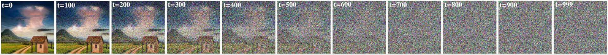
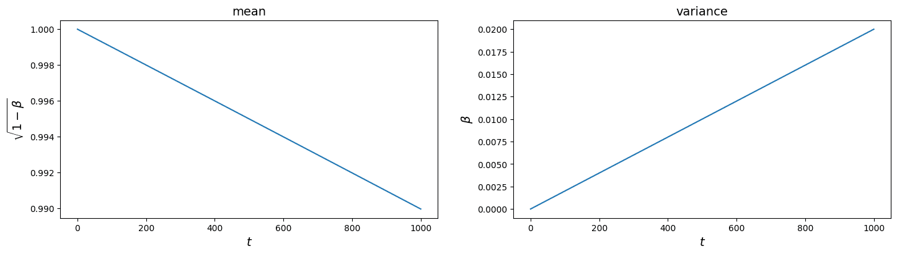
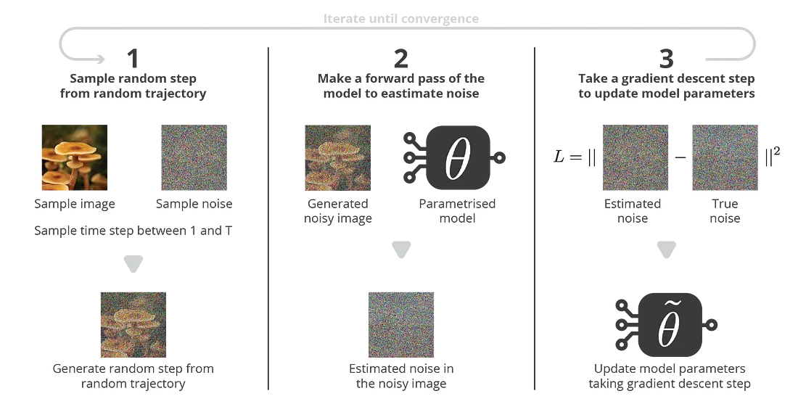
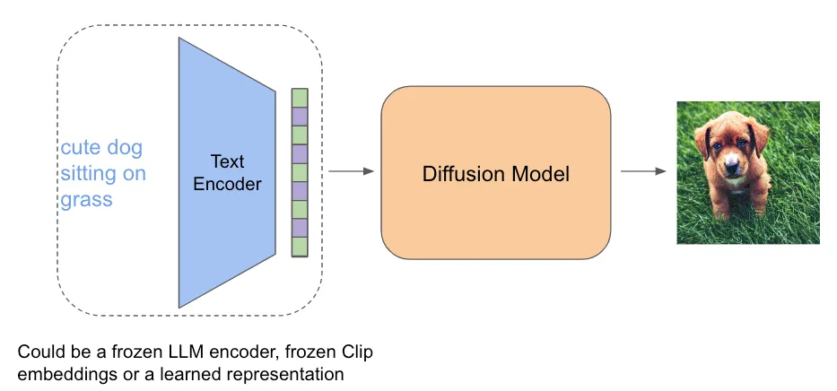

# Diffusion Models {#sec-diffusion}

## Introduction and Intuition

**Diffusion models** generate data by learning to reverse a gradual noising process. Instead of mapping noise to data in one shot (GANs) or compressing and decoding (VAEs), they turn generation into a sequence of **small denoising steps**. Each step is easy to learn, which makes training stable.

1. **Forward process** (fixed, no learning): add Gaussian noise to a training image over $T$ steps until it is pure noise.
2. **Reverse process** (learned): a neural network removes a little noise at each step, going from noise back to an image.

{#fig-forward-strip width=100%}

**Why iterate instead of denoising in one shot?** At high noise levels, the exact position of sharp edges is ambiguous, so a network trained to regress the clean image in one step averages over all plausible alignments and outputs a blur. Iterative denoising avoids this: early steps fix the coarse structure, later steps add edges and texture, and the fresh noise injected at each step keeps the sample consistent with the training distribution.

**Score view**: removing noise is equivalent to moving in the direction that most increases the data likelihood, i.e. following the **score** $\nabla_x \log p(x)$. Diffusion models implicitly learn this score at every noise level.

---

## Forward Diffusion Process

The forward process is a Markov chain that adds a little Gaussian noise at each step, with noise schedule $\beta_t \in (0,1)$:

$$q(x_t \mid x_{t-1}) = \mathcal{N}\big(x_t;\, \sqrt{1-\beta_t}\, x_{t-1},\, \beta_t I\big), \qquad x_t = \sqrt{1-\beta_t}\, x_{t-1} + \sqrt{\beta_t}\, \epsilon_{t-1}$$

The factor $\sqrt{1-\beta_t} < 1$ slightly shrinks the signal at each step so that the total variance stays bounded.

### Closed Form

Define $\alpha_t = 1-\beta_t$ and $\bar\alpha_t = \prod_{s=1}^t \alpha_s$. Composing the Gaussian steps (a sum of independent Gaussians is Gaussian) gives $x_t$ **directly from $x_0$**, with no need to simulate intermediate steps:

$$\boxed{x_t = \sqrt{\bar\alpha_t}\, x_0 + \sqrt{1-\bar\alpha_t}\, \epsilon, \quad \epsilon \sim \mathcal{N}(0, I)} \qquad\Longleftrightarrow\qquad q(x_t \mid x_0) = \mathcal{N}\big(\sqrt{\bar\alpha_t}\, x_0,\, (1-\bar\alpha_t) I\big)$$

As $t \to T$, $\bar\alpha_t \to 0$, so $x_T \approx \mathcal{N}(0, I)$: the process interpolates smoothly between data and pure noise.

::: {.callout-tip collapse="true" appearance="minimal" title="Derivation (click to expand)"}
Unrolling two steps, with $\epsilon_{t-1}, \epsilon_{t-2}$ independent:

$$x_t = \sqrt{\alpha_t}\, x_{t-1} + \sqrt{1-\alpha_t}\, \epsilon_{t-1} = \sqrt{\alpha_t \alpha_{t-1}}\, x_{t-2} + \underbrace{\sqrt{\alpha_t(1-\alpha_{t-1})}\,\epsilon_{t-2} + \sqrt{1-\alpha_t}\,\epsilon_{t-1}}_{\text{Gaussian with variance } 1-\alpha_t\alpha_{t-1}}$$

The sum of the two noise terms has variance $\alpha_t(1-\alpha_{t-1}) + (1-\alpha_t) = 1 - \alpha_t\alpha_{t-1}$. Repeating down to $x_0$ yields $\bar\alpha_t = \prod_s \alpha_s$.
:::

### Noise Schedule

The schedule $\{\beta_t\}$ controls how fast the signal is destroyed.

- **Linear** (DDPM [@ho2020ddpm]): $\beta_t$ increases linearly from $10^{-4}$ to $0.02$ over $T = 1000$ steps (@fig-linear-schedule).
- **Cosine** (Improved DDPM [@nichol2021improved]): defined through $\bar\alpha_t$ instead, so that noise is added more slowly at the beginning and the end:
$$\bar\alpha_t = \frac{f(t)}{f(0)}, \quad f(t) = \cos^2\!\Big(\frac{t/T + s}{1+s}\cdot\frac{\pi}{2}\Big), \quad \beta_t = \text{clip}\Big(1 - \frac{\bar\alpha_t}{\bar\alpha_{t-1}},\, 0.999\Big)$$
The linear schedule destroys the image too early (much of the second half of the chain is nearly pure noise), which wastes steps, especially at low resolution. Cosine spreads the information loss more evenly (@fig-schedules).

{#fig-linear-schedule width=85% fig-align="center"}

{#fig-schedules width=60% fig-align="center"}

---

## Reverse Diffusion Process

We want to invert the forward chain: sample $x_T \sim \mathcal{N}(0,I)$ and denoise step by step. The true reverse transition $q(x_{t-1} \mid x_t)$ is unknown, but for small $\beta_t$ it is approximately Gaussian, so we model it with a network (@fig-markov):

$$p_\theta(x_{t-1} \mid x_t) = \mathcal{N}\big(x_{t-1};\, \mu_\theta(x_t, t),\, \Sigma_\theta(x_t, t)\big), \qquad p_\theta(x_{0:T}) = p(x_T)\prod_{t=1}^{T} p_\theta(x_{t-1} \mid x_t)$$

![The diffusion Markov chain. The forward transition $q(x_t \mid x_{t-1})$ is known, the reverse transition $q(x_{t-1} \mid x_t)$ is unknown, so a model $p_\theta(x_{t-1} \mid x_t)$ is trained with a variational lower bound. Adapted from Ho et al. [@ho2020ddpm]. TODO: confirm source of this version.](/images/diffusion-models/diffusion_markov_chain_graphical_model.png){#fig-markov width=95% fig-align="center"}

### The Tractable Posterior

Although $q(x_{t-1} \mid x_t)$ is unknown, it becomes tractable if we also condition on $x_0$. By Bayes' rule and the Gaussian forward kernels, it is Gaussian:

$$q(x_{t-1} \mid x_t, x_0) = \mathcal{N}\big(x_{t-1};\, \tilde\mu_t(x_t, x_0),\, \tilde\beta_t I\big)$$

$$\tilde\mu_t = \frac{\sqrt{\bar\alpha_{t-1}}\,\beta_t}{1-\bar\alpha_t}\, x_0 + \frac{\sqrt{\alpha_t}\,(1-\bar\alpha_{t-1})}{1-\bar\alpha_t}\, x_t, \qquad \tilde\beta_t = \frac{1-\bar\alpha_{t-1}}{1-\bar\alpha_t}\,\beta_t$$

::: {.callout-tip collapse="true" appearance="minimal" title="Derivation (click to expand)"}
By Bayes' rule, $q(x_{t-1} \mid x_t, x_0) = q(x_t \mid x_{t-1})\, \dfrac{q(x_{t-1} \mid x_0)}{q(x_t \mid x_0)}$. All three factors are Gaussian, so up to a constant in $x_{t-1}$:

$$q(x_{t-1} \mid x_t, x_0) \propto \exp\!\Big(-\tfrac12\Big[\tfrac{(x_t - \sqrt{\alpha_t}\,x_{t-1})^2}{\beta_t} + \tfrac{(x_{t-1} - \sqrt{\bar\alpha_{t-1}}\,x_0)^2}{1-\bar\alpha_{t-1}}\Big]\Big)$$

Collecting terms in $x_{t-1}$ gives a quadratic with precision $\tilde\beta_t^{-1} = \tfrac{\alpha_t}{\beta_t} + \tfrac{1}{1-\bar\alpha_{t-1}}$ and mean $\tilde\mu_t$ as above.
:::

Substituting $x_0 = (x_t - \sqrt{1-\bar\alpha_t}\,\epsilon)/\sqrt{\bar\alpha_t}$ from the closed form turns the mean into a function of $x_t$ and the noise $\epsilon$:

$$\tilde\mu_t = \frac{1}{\sqrt{\alpha_t}}\Big(x_t - \frac{\beta_t}{\sqrt{1-\bar\alpha_t}}\,\epsilon\Big)$$

So instead of predicting the mean, the network can **predict the noise** $\epsilon_\theta(x_t, t)$, and we plug it into this formula.

---

## Training and Sampling (DDPM, 2020)

**Training objective.** The full objective is a variational lower bound (ELBO), a sum of KL terms between $q(x_{t-1} \mid x_t, x_0)$ and $p_\theta(x_{t-1} \mid x_t)$. Since both are Gaussians, each term reduces to a weighted squared error between the true noise $\epsilon$ and the prediction $\epsilon_\theta$. DDPM drops the weights and uses the **simplified loss**:

$$\boxed{\mathcal{L}_{\text{simple}} = \mathbb{E}_{t \sim U\{1,\dots,T\},\, x_0,\, \epsilon}\Big[\big\|\epsilon - \epsilon_\theta\big(\sqrt{\bar\alpha_t}\,x_0 + \sqrt{1-\bar\alpha_t}\,\epsilon,\; t\big)\big\|^2\Big]}$$

In words: pick a random image and a random timestep, noise the image with the closed form, and ask the network what noise was added (@fig-train-diagram).

**Sampling.** Start from $x_T \sim \mathcal{N}(0, I)$ and iterate for $t = T, \dots, 1$:

$$x_{t-1} = \underbrace{\frac{1}{\sqrt{\alpha_t}}\Big(x_t - \frac{\beta_t}{\sqrt{1-\bar\alpha_t}}\,\epsilon_\theta(x_t, t)\Big)}_{\mu_\theta(x_t, t)} + \sigma_t z, \qquad z \sim \mathcal{N}(0, I) \;(z = 0 \text{ at the last step})$$

with $\sigma_t^2 = \beta_t$ or $\tilde\beta_t$. @fig-algorithms shows the two algorithms as given in the paper.

{#fig-train-diagram width=95% fig-align="center"}

![The DDPM training and sampling algorithms. From Ho et al. [@ho2020ddpm], Algorithms 1 and 2.](/images/diffusion-models/ddpm_training_sampling_algorithms.png){#fig-algorithms width=95% fig-align="center"}

**Network**: a time-conditional **U-Net** with sinusoidal timestep embeddings, residual blocks with group normalization, self-attention at low resolutions, and skip connections between encoder and decoder.

::: {.callout-note collapse="true" title="Code: DDPM training loss (PyTorch)"}

```python
betas = torch.linspace(1e-4, 0.02, T)
alpha_bar = torch.cumprod(1 - betas, dim=0)

def ddpm_loss(model, x0):
    t = torch.randint(0, T, (x0.shape[0],))
    eps = torch.randn_like(x0)
    a = alpha_bar[t].view(-1, 1, 1, 1)
    x_t = a.sqrt() * x0 + (1 - a).sqrt() * eps   # closed-form noising
    return torch.nn.functional.mse_loss(model(x_t, t), eps)
```
:::

**Cost**: sampling needs $T \approx 1000$ network evaluations, versus one for GANs and VAEs.

---

## Faster Sampling

### DDIM (2021)

DDPM's chain is not the only process with the marginals $q(x_t \mid x_0)$. **DDIM** [@song2021ddim] uses a non-Markovian process with the same marginals but a different reverse step, which can be made **deterministic** and can **skip timesteps**. Writing $\hat x_0 = (x_t - \sqrt{1-\bar\alpha_t}\,\epsilon_\theta)/\sqrt{\bar\alpha_t}$ for the predicted clean image:

$$x_{t-1} = \sqrt{\bar\alpha_{t-1}}\,\hat x_0 + \sqrt{1-\bar\alpha_{t-1}-\sigma_t^2}\;\epsilon_\theta(x_t,t) + \sigma_t z$$

Here $\sigma_t = \eta\,\tilde\sigma_t$, where $\tilde\sigma_t$ is the DDPM posterior standard deviation: $\eta=1$ recovers DDPM and $\eta=0$ is fully deterministic. The update only involves $x_t$, $\hat x_0$ and $\epsilon_\theta$, so it applies to any pair of timesteps, letting us sample with $S \ll T$ steps (e.g. 50 instead of 1000).

- **Benefits**: much faster; the same $x_T$ always gives the same image; images can be encoded back to noise (inversion).
- **Trade-off**: with few steps, $\eta = 0$ gives better FID than DDPM's $\eta = 1$ (@fig-ddim-table), but fully deterministic sampling is less diverse across runs and may lose some fidelity compared to the full chain.

![FID of generated images for $S$ sampling steps and stochasticity $\eta$. With few steps ($S \le 100$), the deterministic DDIM ($\eta=0$) is far better than DDPM ($\eta=1$); with 1000 steps they are close. From Song et al. [@song2021ddim], Table 1.](/images/diffusion-models/ddim_fid_vs_steps_table.png){#fig-ddim-table width=95% fig-align="center"}

Further speed-ups: **Improved DDPM** [@nichol2021improved] strides over timesteps, ODE solvers (DPM-Solver, UniPC) need 10–20 steps, and **distillation** (progressive distillation, consistency models [@song2023consistency]) compresses sampling to a handful of steps or even one.

---

## Conditional Generation and Guidance

### Score-Based View

The noise prediction is a scaled score. From $q(x_t \mid x_0)$ one gets $\nabla_{x_t} \log q(x_t \mid x_0) = -\epsilon/\sqrt{1-\bar\alpha_t}$, so

$$\nabla_{x_t} \log p(x_t) \approx -\frac{1}{\sqrt{1-\bar\alpha_t}}\,\epsilon_\theta(x_t, t)$$

Sampling then amounts to moving along the learned score from noise towards data; the original **score-based** models did this with Langevin dynamics (gradient ascent on $\log p$ plus noise). In **continuous time** [@song2021scoresde], the forward process is an SDE $dx = f(x,t)\,dt + g(t)\,dw$, and the reverse SDE $dx = [f - g^2 \nabla_x \log p_t(x)]\,dt + g\,d\bar w$ is driven by the score. This gives a unified framework with flexible samplers (SDE or deterministic ODE).

**Conditioning.** To sample from $p(x \mid y)$ (a class or a text prompt), we need the conditional score. By Bayes' rule, $\nabla_x \log p(x \mid y) = \nabla_x \log p(x) + \nabla_x \log p(y \mid x)$: the unconditional score plus a term that pulls the sample towards $y$.

### Classifier Guidance

Train an unconditional diffusion model, plus a separate **classifier** $p_\phi(y \mid x_t)$ on noisy images. At sampling time, shift the noise prediction along the classifier's gradient [@dhariwal2021diffusion]:

$$\boxed{\tilde\epsilon_\theta(x_t, t, y) = \epsilon_\theta(x_t, t) - \gamma\,\sqrt{1-\bar\alpha_t}\;\nabla_{x_t} \log p_\phi(y \mid x_t)}$$

The guidance scale $\gamma$ trades diversity for fidelity to $y$. The drawbacks: it needs a separate classifier trained on noisy inputs at all noise levels, and an extra gradient computation per step.

### Classifier-Free Guidance

Instead of a classifier, use the diffusion model itself [@ho2022classifier]. Rearranging Bayes' rule, $\nabla \log p(y \mid x) = \nabla \log p(x \mid y) - \nabla \log p(x)$, so the guided score is

$$\nabla_x \log p_\gamma(x \mid y) = \nabla_x \log p(x) + \gamma\,\big[\nabla_x \log p(x \mid y) - \nabla_x \log p(x)\big]$$

In terms of noise predictions, with $\emptyset$ the "null" condition:

$$\boxed{\tilde\epsilon_\theta(x_t, t, y) = \epsilon_\theta(x_t, t, \emptyset) + \gamma\,\big[\epsilon_\theta(x_t, t, y) - \epsilon_\theta(x_t, t, \emptyset)\big]}$$

- $\gamma = 0$: unconditional; $\gamma = 1$: standard conditional; $\gamma > 1$: **amplified conditioning** (sharper and more aligned with $y$, less diverse). Text-to-image models typically use $\gamma \approx 5$–$10$.
- **Training**: one network learns both modes. The condition is randomly replaced by a fixed null token for 10–20% of the training examples.
- **Intuition**: the difference $\epsilon_y - \epsilon_\emptyset$ points from the unconditional towards the conditional distribution, and $\gamma > 1$ extrapolates along it.

{#fig-guidance width=90% fig-align="center"}

Classifier-free guidance is the standard in modern text-to-image models, which are trained on (image, caption) pairs. **GLIDE** combined both approaches, using CLIP as the classifier and classifier-free guidance.

---

## Efficiency and Scale

### Latent Diffusion (Stable Diffusion, 2022)

**Problem**: diffusing a $512 \times 512 \times 3$ image is expensive, and most pixels carry perceptually irrelevant detail.

**Solution** [@rombach2022ldm]: first train an autoencoder (encoder $\mathcal{E}$, decoder $\mathcal{D}$) that compresses images into a much smaller latent ($512^2 \times 3 \to 64^2 \times 4$, about 48 times fewer values), then run the diffusion process **in that latent space** with a U-Net that also has **cross-attention layers** for conditioning (@fig-ldm).

![Latent diffusion. An autoencoder maps pixel space to a latent space, where the diffusion process and the denoising U-Net operate. Conditioning (text, semantic maps, images) is injected through cross-attention. From Rombach et al. [@rombach2022ldm].](/images/diffusion-models/latent_diffusion_architecture.png){#fig-ldm width=90% fig-align="center"}

The training loss is the same noise-prediction loss with $z_t = \sqrt{\bar\alpha_t}\,\mathcal{E}(x) + \sqrt{1-\bar\alpha_t}\,\epsilon$ in place of $x_t$. The latent space is kept low-variance with either a small **KL penalty** (as in a VAE, @sec-vae) or a **vector-quantization** layer (as in a VQ-VAE).

**Benefits**: much faster training and sampling, with quality preserved because the decoder restores fine detail. **Cost**: reconstruction artifacts of the autoencoder.

### Cascaded Diffusion

Train a chain of models: a first model generates a low-resolution image (e.g. $32{\times}32$) from noise, and further models **upsample** ($32 \to 64 \to 256$), each conditioned on the previous output (@fig-cascaded). To make the upsamplers robust to imperfections of the previous stage, the low-resolution input is corrupted during training (**conditioning augmentation**, with Gaussian noise or blur) [@ho2022cascaded].

![Cascaded diffusion: a class-conditional base model generates $32{\times}32$ images, which two super-resolution diffusion models upsample to $64{\times}64$ and $256{\times}256$. Figure from Ho et al. [@ho2022cascaded]. TODO: confirm source.](/images/diffusion-models/cascaded_diffusion_pipeline.png){#fig-cascaded width=90% fig-align="center"}

### Text-to-Image

Text-to-image models (DALL-E 2, Imagen, Stable Diffusion) are conditional diffusion models trained with classifier-free guidance on (image, caption) pairs and sampled with fast solvers. The caption is encoded by a pretrained language model (CLIP or a text LLM such as T5) into token embeddings, which the U-Net attends to via **cross-attention** (@fig-text2img). Imagen and DALL-E 2 are cascaded (a base model plus upsamplers), while Stable Diffusion is latent.

{#fig-text2img width=90% fig-align="center"}

### ControlNet and IP-Adapter

- **ControlNet** [@zhang2023controlnet] adds spatial control (edges, pose, depth) to a pretrained model **without retraining it**. It trains a *copy* of the U-Net encoder that receives the conditioning image, and injects its features into the frozen U-Net through **zero-initialized convolutions**. At the start of training the control branch contributes exactly zero, so the pretrained model is untouched and control is learned gradually.
- **IP-Adapter** [@ye2023ipadapter] adds image conditioning (style, composition, variations) with extra cross-attention layers parallel to the text ones.

---

## Recent Advances

- **DiT** [@peebles2023dit]: replaces the U-Net with a Vision Transformer on latent patches, with adaptive layer norm (AdaLN) for the timestep and class conditioning. It scales better than the U-Net.
- **Consistency models** [@song2023consistency]: train a network that maps *any* point of a sampling trajectory to its endpoint $x_0$ ($f_\theta(x_t, t) = f_\theta(x_{t'}, t')$), enabling one-step generation.
- **Flow matching and rectified flow** [@lipman2023flowmatching]: learn a velocity field that transports noise to data along (nearly) **straight paths**. It needs no noise schedule, generalizes diffusion, and gives fast sampling with few steps.

---

## Comparison with GANs and VAEs

| Aspect | Diffusion | GAN | VAE |
|--------|-----------|-----|-----|
| **Sample quality** | ★★★★★ | ★★★★★ | ★★★☆☆ (blurry) |
| **Training stability** | ★★★★☆ | ★★☆☆☆ | ★★★★★ |
| **Mode coverage** | ★★★★★ | ★★☆☆☆ (mode collapse) | ★★★★★ |
| **Sampling speed** | ★☆☆☆☆ (many steps) | ★★★★★ (1 pass) | ★★★★★ (1 pass) |
| **Likelihood** | ✓ (bound) | ✗ | ✓ (lower bound) |
| **Controllability** | ★★★★★ | ★★★☆☆ | ★★★★☆ |

Diffusion models dominate image generation thanks to quality, diversity and controllability, despite slow sampling.

---

## Practical Tips

- **Hyperparameters**: $T=1000$, linear or cosine schedule, Adam(W) with learning rate $\approx 10^{-4}$, U-Net with attention at low resolutions.
- **EMA weights**: keep an exponential moving average of the weights (decay $\approx 0.9999$) and **sample from the EMA model**, not the training weights. This is the most common fix for noisy or blurry samples.
- **Sampler**: DDPM (1000 steps) is the highest quality and slowest, DDIM (50–100 steps) the usual default, DPM-Solver or UniPC (10–20 steps) the fastest.
- **Guidance scale**: higher ($10$–$15$) follows the prompt more closely but is less diverse; lower ($5$–$7$) is more diverse.
- **Monitoring**: the loss decreases smoothly (unlike GANs) but is a poor quality indicator, so also inspect samples from fixed seeds and track FID.

---

## Applications

- **Images**: Stable Diffusion, DALL-E 2/3, Imagen, Midjourney
- **Editing**: Instruct-Pix2Pix, ControlNet, inpainting and outpainting
- **Video**: Make-A-Video, Imagen Video [@ho2022imagenvideo]
- **3D**: DreamFusion (score distillation sampling), Point-E
- **Audio**: AudioLDM, DiffWave

---

## Interview Preparation

### Core Concepts Checklist

- [ ] Derive the closed-form forward process $x_t = \sqrt{\bar\alpha_t}x_0 + \sqrt{1-\bar\alpha_t}\epsilon$
- [ ] Why we predict noise, and the link to the score
- [ ] DDPM training and sampling algorithms
- [ ] DDIM vs DDPM, and how to speed up sampling
- [ ] Classifier guidance vs classifier-free guidance
- [ ] Latent diffusion, cascaded diffusion
- [ ] ControlNet; DiT, consistency models, flow matching

---

### Key Interview Questions

**Q1: "Explain the forward and reverse diffusion processes. Why is the forward process useful?"**

The **forward process** gradually adds Gaussian noise, $q(x_t \mid x_{t-1}) = \mathcal{N}(\sqrt{1-\beta_t}\,x_{t-1}, \beta_t I)$, and the **reverse process** is a learned Gaussian denoiser $p_\theta(x_{t-1} \mid x_t)$. The forward process is useful because (1) its **closed form** lets us sample $x_t$ from $x_0$ at any $t$ in one step, so training is cheap; (2) it provides **exact targets** (the noise $\epsilon$ we added); and (3) it ends at $\mathcal{N}(0, I)$, a trivial starting point for sampling.

---

**Q2: "Why predict the noise $\epsilon$ instead of the mean $\mu$ or $x_0$?"**

The three are **equivalent** parametrizations: given $x_t$, any one of $\epsilon$, $x_0$, $\mu$ determines the others through the closed form. Noise prediction is the empirical winner: the target always has unit variance regardless of $t$, which makes the loss well scaled across timesteps and training stable, whereas the scale of $x_0$-prediction errors varies strongly with $t$.

---

**Q3: "Explain DDIM. How does it sample faster?"**

DDPM's forward process is not unique: there are non-Markovian processes with the **same marginals** $q(x_t \mid x_0)$ but different reverse steps. DDIM's reverse step (with $\sigma_t = 0$) is deterministic and expressed through the predicted $\hat{x}_0$, so it is valid between any two timesteps, allowing us to skip steps: 50–100 instead of 1000. The cost is less diversity across runs, but the same noise always gives the same image, which also enables inversion.

---

**Q4: "What is classifier-free guidance and why is it important?"**

One network is trained both conditionally and unconditionally (the condition is dropped 10–20% of the time). At sampling time, the prediction is extrapolated from the unconditional towards the conditional one, $\tilde\epsilon = \epsilon_\emptyset + \gamma(\epsilon_y - \epsilon_\emptyset)$. It needs **no separate classifier**, gives better alignment, and lets $\gamma$ trade diversity for fidelity. It is the standard for text-to-image models.

---

**Q5: "Why is latent diffusion better than pixel-space diffusion?"**

It runs diffusion in the compressed latent space of an autoencoder ($512^2\times3 \to 64^2\times4$, about 48 times fewer values), which makes both training and sampling much cheaper, while the decoder restores fine detail. It is what allowed high-resolution generation on consumer GPUs (Stable Diffusion). The trade-off is the autoencoder's reconstruction artifacts.

---

**Q6: "Compare diffusion, GANs and VAEs. When do you use each?"**

- **Diffusion**: best quality and diversity, stable training; slow sampling. Use when quality matters and latency is acceptable.
- **GAN**: fast one-pass sampling and high quality; unstable training, mode collapse, no likelihood. Use for real-time generation.
- **VAE**: stable, fast, with an explicit latent space and likelihood bound; blurrier samples. Use for representation learning, latent manipulation, anomaly detection.

---

**Q7: "How would you speed up diffusion sampling?"**

In order of effort: (1) **DDIM** with 50–100 steps; (2) better **ODE solvers** (DPM-Solver, UniPC) with 10–20 steps; (3) **distillation** (progressive distillation, consistency models) down to a few or one step; (4) **latent** diffusion; (5) better architectures (DiT) and efficient attention. Fewer steps cost some quality or diversity, and distillation needs a trained teacher.

---

**Q8: "What is ControlNet and how does it avoid retraining the base model?"**

It freezes the pretrained U-Net, trains a copy of its encoder that takes the control image (edges, pose, depth), and adds the copy's features to the frozen network through **zero-initialized convolutions**. Initially the output is exactly the pretrained model's, and control is learned gradually without degrading quality.

---

**Q9: "How are diffusion models related to score-based models?"**

The noise prediction is a scaled score: $s_\theta(x_t, t) = -\epsilon_\theta(x_t, t)/\sqrt{1-\bar\alpha_t} \approx \nabla_{x_t}\log p_t(x_t)$, so training with $\mathcal{L}_{\text{simple}}$ is denoising score matching at all noise levels. In continuous time, the forward process is an SDE whose reverse SDE is driven by the score, and a deterministic probability-flow ODE with the same marginals enables fast samplers.

---

**Q10: "Your samples are blurry. What could be wrong?"**

1. **Not sampling from the EMA weights** (the most common cause)
2. **Too few sampling steps** for the chosen sampler
3. **Poor noise schedule** (try cosine for high resolution)
4. **Undertrained model** (diffusion needs long training, check the loss is still decreasing)
5. **Wrong variance setting** if the variance is learned (fix it to $\beta_t$ or $\tilde\beta_t$ first)
6. **Conditioning problems** (cross-attention or embedding dimensions) for conditional models

Debug by enabling EMA, sampling with 1000 steps, and comparing against a pretrained model.

---

### Company-Specific Context

- **Anthropic**: focus on safety and controllability; diffusion is relevant for data augmentation and understanding representations.
- **OpenAI**: DALL-E 2/3 (diffusion decoders with CLIP conditioning), prompt alignment and safety.
- **Stability AI**: Stable Diffusion, open-source latent diffusion, efficiency.
- **NVIDIA**: efficiency, fast sampling and GPU optimization for diffusion.
- **Google DeepMind**: Imagen, theory and SDE formulations.

---

### Further Reading

**Foundational papers**:

- [Denoising Diffusion Probabilistic Models](https://arxiv.org/abs/2006.11239) (DDPM, Ho et al., 2020)
- [Denoising Diffusion Implicit Models](https://arxiv.org/abs/2010.02502) (DDIM, Song et al., 2021)
- [Improved Denoising Diffusion Probabilistic Models](https://arxiv.org/abs/2102.09672) (Nichol & Dhariwal, 2021)
- [Score-Based Generative Modeling through SDEs](https://arxiv.org/abs/2011.13456) (Song et al., 2021)

**Guidance, scale and control**:

- [Diffusion Models Beat GANs on Image Synthesis](https://arxiv.org/abs/2105.05233) (classifier guidance, 2021)
- [Classifier-Free Diffusion Guidance](https://arxiv.org/abs/2207.12598) (Ho & Salimans, 2022)
- [High-Resolution Image Synthesis with Latent Diffusion Models](https://arxiv.org/abs/2112.10752) (Rombach et al., 2022)
- [Scalable Diffusion Models with Transformers](https://arxiv.org/abs/2212.09748) (DiT, 2023)
- [Adding Conditional Control to Text-to-Image Diffusion Models](https://arxiv.org/abs/2302.05543) (ControlNet, 2023)

**Fast sampling**:

- [Consistency Models](https://arxiv.org/abs/2303.01469) (Song et al., 2023)
- [Flow Matching for Generative Modeling](https://arxiv.org/abs/2210.02747) (Lipman et al., 2023)

**Tutorials**: [Lilian Weng, "What are Diffusion Models?"](https://lilianweng.github.io/posts/2021-07-11-diffusion-models/), [Sander Dieleman, "Guidance"](https://sander.ai/2022/05/26/guidance.html), [AI Summer, "How diffusion models work"](https://theaisummer.com/diffusion-models/).

---

**This completes the generative modeling chapters.** Diffusion models combine stable training with state-of-the-art quality and diversity, and their main weakness, slow sampling, is being addressed by faster solvers, distillation, latent-space diffusion and flow-based formulations.
